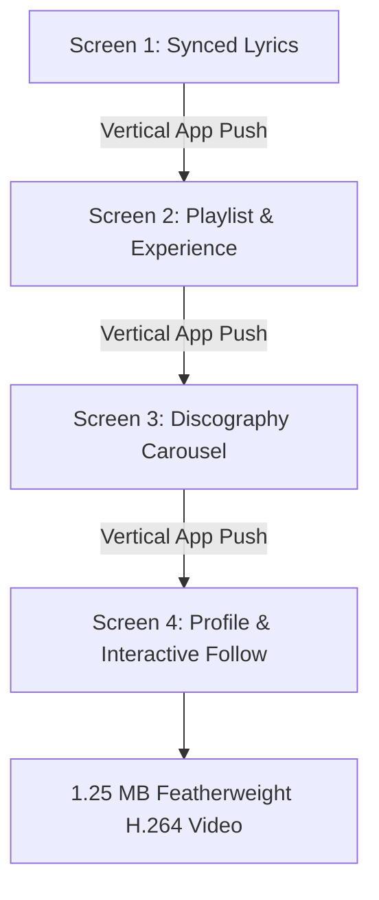

# App UI & Native Product Simulation Motion Graphics

"The Resume is the App" represents the ultimate evolution in procedural motion design. Rather than showing abstract geometric shapes or generic video templates, the animation faithfully simulates the interactive user interface of a modern streaming app (e.g., Spotify, Apple Music). Every standard digital UX component is repurposed as an element of the candidate's career story or product showcase.



---

## 1. Conceptual Framework: "The Resume IS the App"

| App Screen | Real App Function | Motion Resume Metaphor |
| :--- | :--- | :--- |
| **0 - 4s: Synced Lyrics (`LETRA`)** | Real-time karaoke lyrics display | Punchy opening statement / elevator pitch |
| **4 - 9s: Playlist (`Currículo`)** | Tracklist with album art, artist, duration | Work experience & core competencies as tracks |
| **9 - 12s: Discography Carousel** | Horizontal album carousel & listener count | Key portfolio projects & verified impact metrics |
| **12 - 15s: Artist Profile** | Verified artist header & "Follow" button | Call to action with interactive cursor click |

---

## 2. Karaoke-Style Synced Lyrics Engine

In a real music streaming app, lyrics highlight word-by-word in lockstep with the vocals, while the text smoothly auto-scrolls vertically and the background shifts color.

### 2.1 Word-by-Word Timing & Illumination
Assign a precise timestamp $t_w$ to each individual word:

```python
words = [w for line in LINES for w in line.split()]
wt = [0.25 + i * 0.33 for i in range(len(words))]  # timestamp per word
```

For each word:
1. **Unsung Words (Future Lines)**: Render in deeply dimmed background shade (`lerpc(bg_color, (0, 0, 0), 0.45)`).
2. **Current Sung Word**: Rapidly illuminates to pure white via cubic deceleration:
   ```python
   k = ease_out_cubic(prog(t, wt[wi], wt[wi] + 0.15))
   col = lerpc(dim_color, WHITE, k)
   ```
3. **Sung Words (Past Lines)**: Remain crisp and legible.

### 2.2 Smooth Line Autoscroll
As each line concludes, the entire viewport smoothly scrolls up by one line height ($\Delta y \approx 95\text{px}$) using cubic S-curve interpolation:

```python
scroll = 0.0
for li in range(1, len(LINES)):
    line_start_t = wt[line_indices[li]] - 0.2
    scroll += ease_in_out_cubic(prog(t, line_start_t, line_start_t + 0.4)) * 95.0
```

### 2.3 Background Color Crossfading
The canvas background smoothly blends into a new brand palette color on every line transition:
```python
bg_color = lerpc(bg_color, NEXT_COLOR, ease_in_out_cubic(prog(t, line_start_t, line_start_t + 0.4)))
```

---

## 3. Native App View Transitions: Vertical Push (Swipe)

In mobile and modern desktop operating systems, switching views or scrolling feeds uses a **vertical push / swipe**. The incoming screen physically pushes the outgoing screen upward:

```python
def vertical_push_transition(img_curr: Image.Image, img_prev: Image.Image, progress: float) -> Image.Image:
    progress = clamp(progress, 0.0, 1.0)
    k = ease_in_out_cubic(progress)
    offset_y = int(k * img_curr.height)
    
    canvas = Image.new("RGB", img_curr.size)
    canvas.paste(img_prev, (0, -offset_y))
    canvas.paste(img_curr, (0, img_curr.height - offset_y))
    return canvas
```

**Why this works**:
- Creates the unmistakable psychological feeling of a real touch or scroll interaction.
- Eliminates visual jarring by preserving 100% spatial continuity between scenes.

---

## 4. Generative Procedural Album Cover Art

Real music interfaces require album artwork thumbnails. Rather than loading external PNG files, generate unique geometric album art procedurally using deterministic random seeds:

```python
def generative_cover(pen: Pen, x: float, y: float, size: float, seed: int, base_color: Tuple[int, int, int]):
    pen.rect(x, y, x + size, y + size, base_color, r=6)
    dark_tint = lerpc(base_color, (0, 0, 0), 0.35)
    rng = np.random.RandomState(seed)
    pattern_type = seed % 3
    
    if pattern_type == 0:    # Overlapping translucent bubbles
        for _ in range(4):
            pen.ell(x + size * rng.uniform(0.2, 0.8),
                    y + size * rng.uniform(0.2, 0.8),
                    size * rng.uniform(0.1, 0.25), dark_tint)
    elif pattern_type == 1:  # Graphic horizontal stripes
        for i in range(5):
            pen.rect(x + size * 0.1, y + size * (0.12 + i * 0.16),
                     x + size * rng.uniform(0.3, 0.9), y + size * (0.20 + i * 0.16),
                     dark_tint)
    else:                    # Bold geometric triangle
        pen.poly([(x + size * 0.50, y + size * 0.15),
                  (x + size * 0.88, y + size * 0.85),
                  (x + size * 0.12, y + size * 0.85)], dark_tint)
```

---

## 5. Active Track Audio Equalizer in Playlists

In a music app playlist, the track currently playing does not display a static track number (e.g. `"1"`). Instead, it shows a **3-bar green equalizer animation** while highlighting the row with a card background:

```python
def mini_eq_bars(pen: Pen, x: float, y: float, t: float, color: Tuple[int, int, int]):
    for i in range(3):
        h = 6 + 12 * abs(math.sin(t * (7.0 + i * 2.3) + i))
        pen.rect(x + i * 7, y - h, x + i * 7 + 4, y, color)
```

By advancing `active_track_index = int(t / 0.7s)`, the green highlight and equalizer visibly walk down the resume tracklist!

---

## 6. Interactive Micro-Interactions & Cursor Physics

Adding a virtual mouse cursor turns a passive animation into an engaging product demonstration.

### 6.1 OS Cursor Path
Move a clean vector mouse pointer along an S-curve path toward the interactive button:
```python
cx = lerp(900, 660, ease_in_out_cubic(prog(t, 0.9, 1.3)))
cy = lerp(700, target_y + 8, ease_in_out_cubic(prog(t, 0.9, 1.3)))
pen.poly([(cx, cy), (cx, cy + 30), (cx + 8, cy + 22), (cx + 20, cy + 22)], WHITE)
```

### 6.2 Button Click Depression (Tactile Springback)
When clicked, the button physically depresses by 8%, then springs back to 100%:
```python
press = prog(t, t_click, t_click + 0.15) - prog(t, t_click + 0.15, t_click + 0.35)
button_scale = 1.0 - 0.08 * clamp(press, 0.0, 1.0)
```

### 6.3 Expanding Shockwave Ripple
At the moment of click, emit an expanding radial ripple from the button center:
```python
if t_click < t < t_click + 0.65:
    p = prog(t, t_click, t_click + 0.65)
    r = ease_out_cubic(p) * 120.0
    pen.ell(center_x, center_y, r, outline=lerpc(GREEN, BG, p), width=3)
```

### 6.4 Button State Morphing
Morph the button from an outline state (`"FOLLOW"`, $200\text{px}$) to a solid brand state (`"LET'S WORK ✓"`, $330\text{px}$) by interpolating width via `lerp(200, 330, ease_out_cubic(...))`.

---

## 7. Featherweight Bitrate: Why V3 Reaches 1.25 MB

| Version | Visual Direction | File Size (15s @ 720p) | Bitrate Factor |
| :--- | :--- | :--- | :--- |
| **Version 1** | Dark Cyber Glow + Film Grain | 48.8 MB | $39\times$ larger |
| **Version 2** | Flat Wrapped Editorial | 2.7 MB | $2.1\times$ larger |
| **Version 3** | **App UI & Product Simulation** | **1.25 MB** | **Reference (Lowest)** |

Dark UI themes (`#121212`, card containers `#1F1F1F`) combined with crisp SSAA vector geometry create maximum macroblock temporal consistency. H.264 P-frames require negligible byte counts to encode moving cursors or sliding text over flat cards. This yields broadcast-grade visual polish in a featherweight video that loads instantaneously anywhere.
