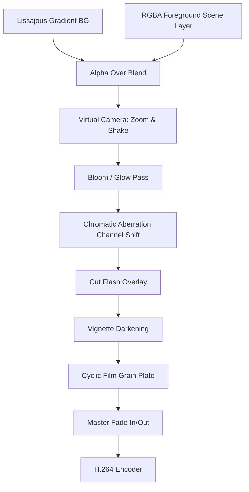

# Multi-Pass Compositing & Post-Processing Pipeline

Raw vector drawings look sterile and flat. High-end motion graphics achieve their cinematic look through a multi-pass compositing pipeline applied to every frame.



---

## 1. Lissajous Gradient Background

Static solid backgrounds feel dead. A drifting dual-radial gradient keeps the canvas alive without stealing focus:

```python
# Centre drifts along orthogonal sinusoidal frequencies
ax = cx + math.cos(t * 0.7) * 500
ay = cy + math.sin(t * 0.9) * 250
dist = np.sqrt((xx - ax)**2 + (yy - ay)**2) / 1400
g = np.exp(-dist * 3.0)[..., None]
bg = np.array(BG, np.float32) + g * np.array(tint, np.float32) * 0.22
```

The scene dynamically supplies the `tint` vector, shifting atmospheric mood across scene boundaries.

---

## 2. Downsampled Bloom / Glow Pass

Simulates camera lens diffusion around emissive neon surfaces.

### Algorithm:
1. Downscale the composited frame by 4x using bilinear filtering (for extreme speed).
2. Apply a Gaussian blur with radius $\sigma = 8$.
3. Upscale back to native resolution ($1920 \times 1080$).
4. Threshold bright areas: subtract luminance floor ($\tau = 90$), clamp negative values to zero.
5. Add back to the original image multiplied by glow intensity ($\alpha = 0.55$).

```python
small = Image.fromarray(img.clip(0, 255).astype(np.uint8)).resize((W // 4, H // 4), Image.BILINEAR)
glow = np.asarray(small.filter(ImageFilter.GaussianBlur(8)).resize((W, H), Image.BILINEAR), np.float32)
img = img + np.maximum(glow - 90, 0) * 0.55
```

---

## 3. Dynamic Chromatic Aberration

Simulates lens dispersion by displacing color channels horizontally:
- Shift Red channel right by $+\delta$ pixels.
- Shift Blue channel left by $-\delta$ pixels.
- Green channel remains centered.

```python
since_cut = t - scene_start_time
# Spikes up to 16px on cut hits, settles to 2px baseline
ca = 2 + int(14 * max(0.0, 1.0 - since_cut / 0.2))
img[..., 0] = np.roll(img[..., 0], ca, axis=1)
img[..., 2] = np.roll(img[..., 2], -ca, axis=1)
```

---

## 4. Anti-Banding Film Grain (Dithering)

8-bit H.264 compression (`yuv420p`) suffers heavily from color banding (contouring) in smooth radial gradients.

To eliminate banding and add organic cinematic texture:
1. Precompute 6 Gaussian noise plates ($\mu = 0, \sigma = 7.0$).
2. Cycle through the noise plates frame-by-frame (`grain[i % 6]`).
3. Add noise directly to floating-point RGB buffer before 8-bit clipping.

```python
GRAIN = [np.random.normal(0, 7, (H, W, 1)).astype(np.float32) for _ in range(6)]
img = img + GRAIN[frame_idx % len(GRAIN)]
```

---

## 5. Vignette Falloff

Darkens outer corners to focus the viewer's eye on the center hero action:

$$V(x, y) = \text{clip}\left(1.0 - 0.65 \cdot \left(\frac{r}{r_{\max}}\right)^2, 0.0, 1.0\right)$$

```python
yy, xx = np.mgrid[0:H, 0:W].astype(np.float32)
rr = np.sqrt((xx - cx)**2 + (yy - cy)**2) / math.hypot(cx, cy)
VIGNETTE = (1.0 - 0.65 * rr**2).clip(0, 1)[..., None]
img = img * VIGNETTE
```

---

## 6. Flash Frames & Camera Shake

- **Cut Punctuations**: On hard scene boundaries, blend a 60% white frame for 2 frames ($t - t_{\text{cut}} < 2 / \text{FPS}$).
- **Impact Jitter**: When high-mass elements strike (particle explosions, hard cuts), apply 2D pixel offset jitter decaying over 0.35s:

```python
if shake > 0:
    layer = ImageChops.offset(layer, int(random.uniform(-shake, shake)), int(random.uniform(-shake, shake)))
```
