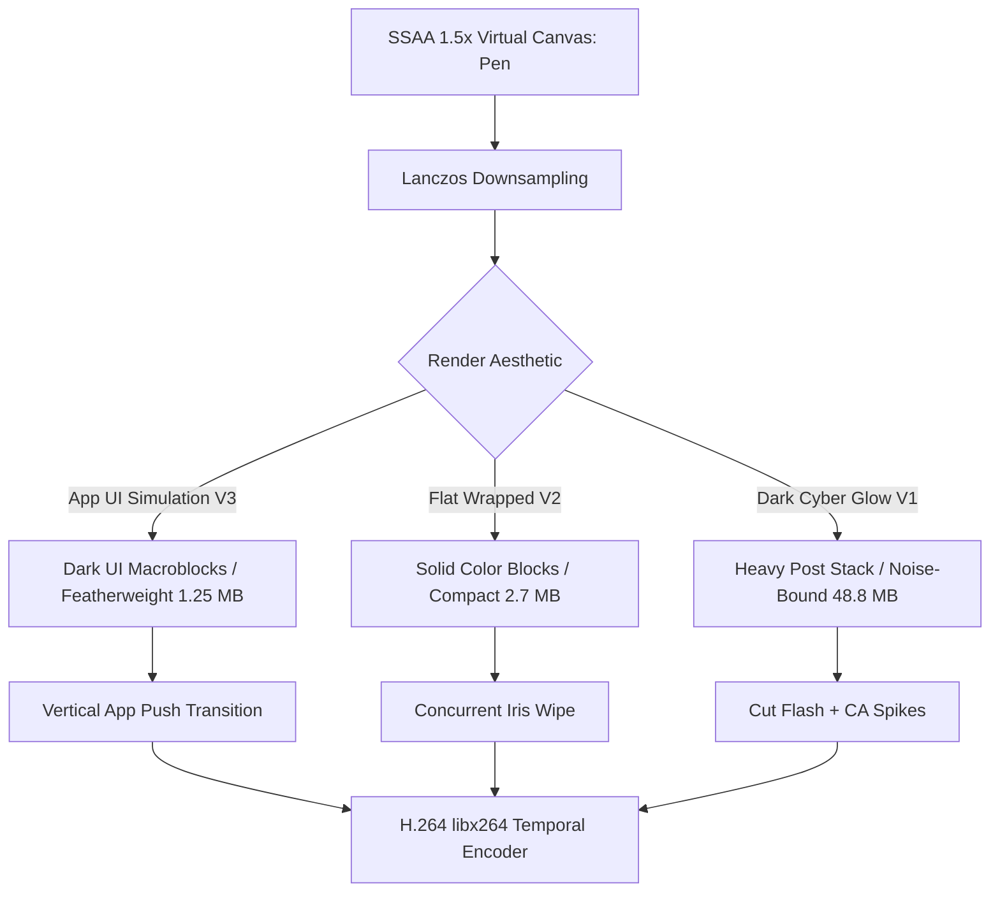

# Rendering Architecture, Compositing & Bitrate Pipeline

Broadcast-grade motion graphics in pure Python require careful attention to image quality, transition mechanics, and video compression efficiency.



---

## 1. Super-Sampled Anti-Aliasing (SSAA)

### 1.1 The Aliasing Problem in CPU Drawing
Pillow's rasterization engine relies on integer scanline algorithms. When drawing diagonal polygon edges, rotated text, or high-radius arcs at native resolution ($1280 \times 720$), stair-stepping / jagged pixel artifacts become immediately visible.

### 1.2 The SSAA Solution: 1.5x Lanczos Downsampling
To achieve razor-sharp vector rendering without GPU shader pipelines:
1. **Virtual Coordinate Space**: Design layouts in standard $1280 \times 720$ coordinates.
2. **Super-Sampled Render Buffer**: Scale coordinates, radii, and typography by $K = 1.5\times$ (rendering internally at $1920 \times 1080$).
3. **Lanczos Downsampling**: At the end of the frame lifecycle, downsample back to $1280 \times 720$ using `Image.LANCZOS` (3-lobed Sinc windowed filter).

```python
class Pen:
    def __init__(self, bg, width=1280, height=720, k=1.5):
        self.k = k
        self.im = Image.new("RGB", (int(width * k), int(height * k)), bg)
        self.d = ImageDraw.Draw(self.im)
        
    def rect(self, x0, y0, x1, y1, fill, r=0):
        b = [x0 * self.k, y0 * self.k, x1 * self.k, y1 * self.k]
        if r: self.d.rounded_rectangle(b, r * self.k, fill=fill)
        else: self.d.rectangle(b, fill=fill)
        
    def render(self):
        return self.im.resize((1280, 720), Image.LANCZOS)
```

---

## 2. Transition Mechanics

### 2.1 Native App Vertical Push (Swipe)
Simulates authentic mobile and desktop screen navigation:

```python
def vertical_push_transition(img_curr: Image.Image, img_prev: Image.Image, progress: float) -> Image.Image:
    progress = clamp(progress, 0.0, 1.0)
    k = ease_in_out_cubic(progress)
    offset_y = int(k * img_curr.height)
    
    canvas = Image.new("RGB", img_curr.size)
    canvas.paste(img_prev, (0, -offset_y))
    canvas.paste(img_curr, (0, img_curr.height - offset_y))
    return canvas
```

### 2.2 Concurrent Iris Wipes
Reveals the incoming scene from the center outward while the outgoing scene continues actively animating in the background:

```python
def iris_wipe(img_curr: Image.Image, img_prev: Image.Image, progress: float) -> Image.Image:
    w, h = img_curr.size
    max_radius = math.hypot(w / 2.0, h / 2.0)
    r = smoothstep(progress) * max_radius
    
    mask = Image.new("L", (w, h), 0)
    ImageDraw.Draw(mask).ellipse(
        [w / 2.0 - r, h / 2.0 - r, w / 2.0 + r, h / 2.0 + r],
        fill=255
    )
    return Image.composite(img_curr, img_prev, mask)
```

---

## 3. Video Compression & Bitrate Efficiency: The 3-Way Comparison

| Metric | Version 1 (Cyber Glow) | Version 2 (Flat Wrapped) | Version 3 (App UI Simulation) |
| :--- | :--- | :--- | :--- |
| **Video File Size (15s @ 720p)** | **48.8 MB** | **2.7 MB** | **1.25 MB (Featherweight!)** |
| **Compression Ratio vs. V1** | $1\times$ (Baseline) | **$18\times$ smaller** | **$39\times$ smaller** |
| **Visual Direction** | Dark neon, bloom, grain | Flat color-block editorial | Native digital music player UI |
| **Temporal Redundancy** | Low (Noise destroys P/B frames) | Very High (Solid color blocks) | **Extreme (Consistent dark UI surfaces)** |
| **Rendering Speed** | Slowest (Float post passes) | Fast | **Fastest (Direct vector rasterization)** |

### 3.1 Why V3 Achieves Unprecedented Compression
H.264 video compression relies heavily on temporal macroblock matching.
1. **Consistent Dark Surfaces**: The persistent `#121212` background and `#1F1F1F` card backgrounds remain mathematically identical across seconds of playback.
2. **Minimal Pixel Variance**: Only small, focused regions (moving mouse cursor, text highlight, 3 equalizer bars) change from frame to frame.
3. **No Entropy Spoilers**: Without film grain noise or drifting gradient dithers, P-frames and B-frames require only a handful of bits to encode movement.
4. **Result**: A 15-second, 30fps broadcast-quality video rendering in just **1.25 megabytes**, making it instant to load on any mobile device or web browser.
