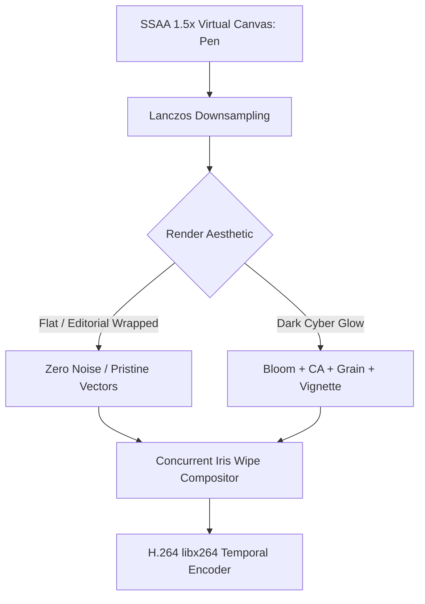

# Rendering Architecture, Compositing & Bitrate Pipeline

Broadcast-grade motion graphics in pure Python require careful attention to image quality, transition mechanics, and video compression efficiency.



---

## 1. Super-Sampled Anti-Aliasing (SSAA)

### 1.1 The Aliasing Problem in CPU Drawing
Pillow's rasterization engine relies on integer scanline algorithms. When drawing diagonal polygon edges, rotated text, or high-radius arcs at native resolution ($1280 \times 720$), stair-stepping / jagged pixel artifacts become immediately visible.

### 1.2 The SSAA Solution: 1.5x Lanczos Downsampling
To achieve razor-sharp vector rendering without GPU shader pipelines:
1. **Virtual Coordinate Space**: Design layouts in standard $1280 \times 720$ coordinates.
2. **Super-Sampled Render Buffer**: Scale coordinates, radii, and typography by $K = 1.5\times$ (rendering internally at $1920 \times 1080$).
3. **Lanczos Downsampling**: At the end of the frame lifecycle, downsample back to $1280 \times 720$ using `Image.LANCZOS` (3-lobed Sinc windowed filter).

```python
class Pen:
    def __init__(self, bg, width=1280, height=720, k=1.5):
        self.k = k
        self.im = Image.new("RGB", (int(width * k), int(height * k)), bg)
        self.d = ImageDraw.Draw(self.im)
        
    def rect(self, x0, y0, x1, y1, fill, r=0):
        b = [x0 * self.k, y0 * self.k, x1 * self.k, y1 * self.k]
        if r: self.d.rounded_rectangle(b, r * self.k, fill=fill)
        else: self.d.rectangle(b, fill=fill)
        
    def render(self):
        return self.im.resize((1280, 720), Image.LANCZOS)
```

**Benefits**:
- Zero jagged edges on angled vectors or smooth text.
- 100% deterministic CPU rendering without external OpenGL/Vulkan runtimes.

---

## 2. Seamless Scene Transitions

### 2.1 Concurrent Iris Wipes
Rather than abrupt hard cuts, an iris wipe reveals the incoming scene from center outward while **the outgoing scene continues animating in the background**:

```python
def iris_wipe(img_curr: Image.Image, img_prev: Image.Image, progress: float) -> Image.Image:
    w, h = img_curr.size
    max_radius = math.hypot(w / 2.0, h / 2.0)
    r = smoothstep(progress) * max_radius
    
    mask = Image.new("L", (w, h), 0)
    ImageDraw.Draw(mask).ellipse(
        [w / 2.0 - r, h / 2.0 - r, w / 2.0 + r, h / 2.0 + r],
        fill=255
    )
    return Image.composite(img_curr, img_prev, mask)
```

### 2.2 Sliding Reveal Masks (Stencils)
Create Swiss editorial reveals by drawing headline typography and placing a sliding background-colored rectangle that slides away to the right:

```python
text_w = pen.tw(headline, size=100)
pen.txt(x, y, headline, 100, WHITE, anchor="lm")
# Reveal mask: background block slides off to the right
wipe_k = smoothstep(prog(t, t_start, t_end))
pen.rect(x + text_w * wipe_k - 2, y - 60, x + text_w + 30, y + 60, BG_COLOR)
```

---

## 3. Video Compression & Bitrate Efficiency: Flat vs. Noisy

| Metric | Version 1 (Dark Glow + Grain) | Version 2 (Flat Wrapped SSAA) |
| :--- | :--- | :--- |
| **Video File Size (15s @ 720p)** | **48.8 MB** | **2.7 MB (18x smaller!)** |
| **Visual Style** | Cyber neon, bloom, grain plates | Flat color-block, Swiss editorial |
| **Temporal Redundancy** | Extremely low (noise destroys P/B frames) | Extremely high (solid macroblocks) |
| **Visual Sharpness** | Diffuse, blurred by bloom/grain | Razor-sharp, vector crispness |
| **Encoding Speed** | Slower (heavy float post-processing) | Faster (pure vector drawing + SSAA) |

### 3.1 Why Grain Destroys Compression
H.264 video encoders rely on **Motion Estimation** and **Temporal Redundancy** (storing differences between adjacent frames in P-frames and B-frames).
- **Procedural Film Grain**: Adding pseudo-random Gaussian noise plates ($\sigma = 7.0$) introduces uncorrelated high-frequency changes in every single pixel every single frame.
- The encoder cannot find matching macroblocks from previous frames, forcing it to allocate massive bitrate to encode noise.

### 3.2 The Flat Vector Advantage
When using flat color-block design:
- Solid background areas compress to near-zero bytes across consecutive frames.
- Motion vectors cleanly track moving edges.
- Result: **Broadcast-grade visual impact at 1/18th the file size**, ideal for web delivery, social sharing, and instant loading.

---

## 4. Multi-Pass Glow Pipeline (When Dark Aesthetic is Needed)

When a dark cyber aesthetic is explicitly required, apply the multi-pass post stack:

1. **Downsampled Bloom**: Downscale 4x $\to$ Gaussian blur ($\sigma=8$) $\to$ threshold subtract ($\tau=90$) $\to$ additive blend.
2. **Chromatic Aberration**: Displace Red right and Blue left by $2-16\text{px}$ on cut beats.
3. **Vignette**: Radial quadratic falloff $(1.0 - 0.65 \cdot r^2)$.
4. **Camera Shake**: 2D coordinate displacement on percussive hits.
