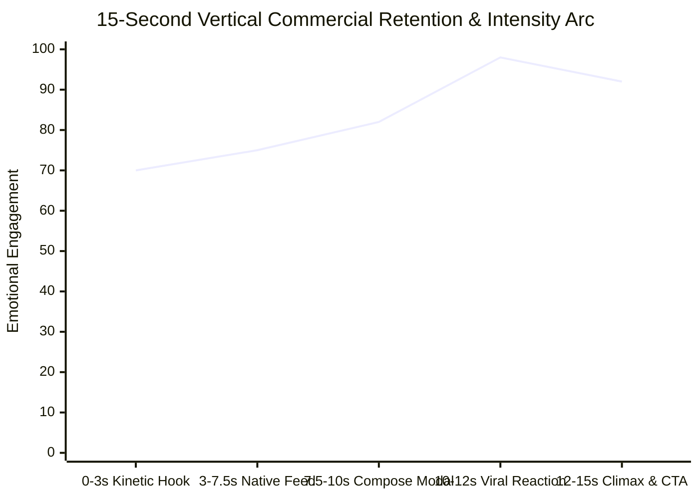

# Creative Direction, Pacing & Design Aesthetics

Motion graphics succeed or fail on rhythm, clarity, and art direction. Procedural motion in Python supports four progressive architectural paradigms, culminating in **Pillar 1: Full-HD Vertical Mobile Product Ad & Procedural DSP Audio (V4 Desired Architecture)** as the golden standard for commercial and social storytelling.

---

## 1. Architectural Evolution: V1 $\to$ V2 $\to$ V3 $\to$ V4

| Dimension | Version 1: Landscape Sci-Fi Vacuum | Version 2: Landscape Desktop App Simulator | Version 3: Minimal Vertical Feed Prototype | Version 4: Full HD Vertical Mobile Ad (Desired) |
| :--- | :--- | :--- | :--- | :--- |
| **Aspect Ratio & Resolution** | 1920x1080 (16:9 Landscape) | 1920x1080 (16:9 Landscape) | 720x1280 (9:16 Vertical) | **1080x1920 Full HD (9:16 Vertical)** |
| **Visual Tone** | Cyberpunk sci-fi grid, floating rings, star particles | Authentic brand palette, glassmorphism post card | Flat minimal feed scroll | **Hyper-realistic native mobile operating system & app timeline** |
| **Rasterization Quality** | 1x standard PIL (aliased) | 1x standard PIL (aliased) | 1.5x SSAA Lanczos (clean) | **1.5x SSAA Lanczos ($1620\times 2880$) + Bounded Alpha Blits** |
| **Interactivity & Gestures** | None (static text pop-ins) | Mouse pointer cursor with button click | Feed scrolling | **Touch tap indicator (soft finger pad + pressure dip + shockwave ripple)** |
| **Modal & Keyboards** | None | None | None | **Slide-up bottom sheet modal (`sheet_up`), QWERTY keyboard with active key magnification pop** |
| **Dynamic Notifications** | None | None | None | **Ramping live metric counters, floating hearts, staggered sliding notification toasts, bell badge to "99+"** |
| **Audio Engine** | Naive NumPy synth (drone + kick + hat), mono | 128 BPM electronic synth, mono | Basic 4-chord pad, mono | **Stereo binaural DSP with SciPy Butterworth filters, side-chain ducking, frame-accurate UI Foley sound design** |
| **Rendering Engine** | Single-threaded sequential | Single-threaded sequential | Single-threaded sequential | **Multi-core parallel processing (`multiprocessing.Pool`), CLI `--preview` still generator** |

---

## 2. The 15-Second 5-Act Mobile Ad Narrative Framework (V4)

### Act 1: The Kinetic Hook ($0.00\text{s} - 3.05\text{s}$)
- **Objective**: Prevent scrolling within the critical first 3 seconds.
- **Visuals**: Exponential kinetic typography ("Breaking news." $\to$ "Live sports." $\to$ "Hot takes." $\to$ "Big ideas.") slammed down onto the screen, accompanied by a pulsing "Happening now" live chip.
- **Pacing**: Staggered downbeat entries every $0.50\text{s}$, followed by an upward text flush making way for the grand slam: **"It's all happening."** with a cyan underline sweep.
- **Audio**: Downbeat tick slams, rising noise envelope, and open hi-hat drop into Act 2.

### Act 2: The Native Timeline ($3.05\text{s} - 7.55\text{s}$)
- **Objective**: Establish product familiarity and visual delight.
- **Transition**: Smooth vertical push transition (`push`).
- **Visuals**: Authentic timeline feed featuring system status bar (`9:41`), segmented tab bar (`For you` / `Following`), and rich posts. Incorporates procedural animated media (e.g. rocket launch with procedural smoke particles and flames; sports score card with live confetti).
- **Interactions**: Feed scrolls smoothly to reveal a relatable post. A translucent finger touch tap presses the like button, triggering a heart scale bounce and colorful particle explosion. Floating Action Button (`+`) receives an interactive tap.
- **Audio**: Four-on-the-floor kick, rhythmic clap, 16th-note hi-hats, melodic bassline, finger tap click, and heart pop bubble sound effect.

### Act 3: The Compose Sheet Modal ($7.55\text{s} - 10.05\text{s}$)
- **Objective**: Empowers the viewer as an active creator.
- **Transition**: Bottom sheet slides up (`sheet_up`) over a dimmed feed backdrop.
- **Visuals**: A full virtual QWERTY keyboard appears. Text types in character-by-character ("Hello, X. What's everyone talking about?") with active key magnification pop-ups. A blue circular progress ring measures remaining characters.
- **Action**: Tap on the "Post" button triggers an expanding shockwave ripple.
- **Audio**: Synchronized mechanical keystroke tick-clacks, tap SFX, and ascending post-send frequency whoosh.

### Act 4: The Viral Payoff ($10.05\text{s} - 12.05\text{s}$)
- **Objective**: Deliver instant gratification and social proof.
- **Visuals**: View zooms into the published post. View counters ramp exponentially ($284\text{K}$ views, $12.4\text{K}$ likes). Translucent floating hearts drift upwards. Multiple notification toast alerts ("Maya Chen and 1,208 others liked your post", "Goal Line reposted") slide in from the right. The notification bell badge jumps to "99+".
- **Audio**: Ascending resonant harmonic chimes ($659\text{Hz}$, $784\text{Hz}$, $880\text{Hz}$).

### Act 5: Monumental Climax & CTA ($12.05\text{s} - 15.00\text{s}$)
- **Objective**: Cement brand identity and drive conversion.
- **Transition**: Zoom cut into a deep radial glow background.
- **Visuals**: Massive brand logo reveal with dual expanding shockwave rings and ambient radial glow. Crisp slogan ("Join the conversation.").
- **Interactivity**: An authentic CTA button ("Get the app") receives a touch tap, depresses by 8%, emits a shockwave ripple, and settles before a graceful fade-out.
- **Audio**: Massive sub-drop impact boom with highpass crash, warm analog pad resolution, and soft chime tap.
