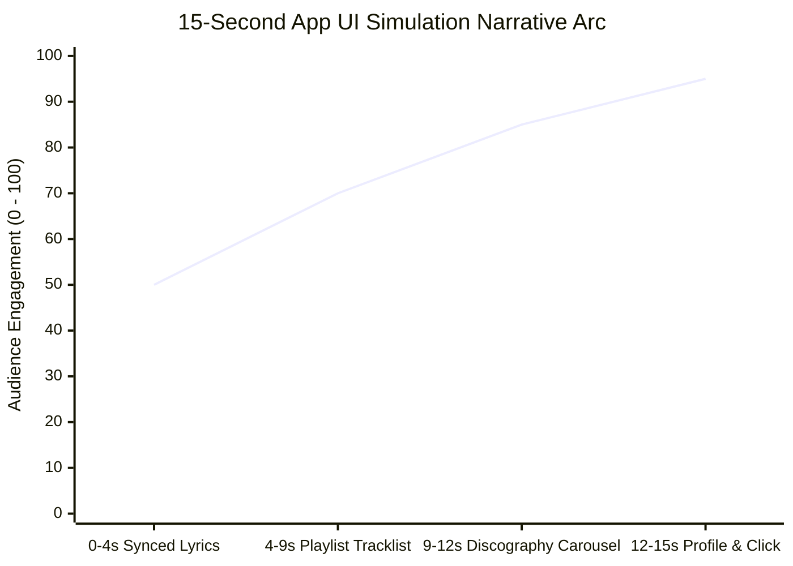

# Creative Direction, Pacing & Design Aesthetics

Motion graphics succeed or fail on rhythm, clarity, and art direction. Procedural motion in Python supports three distinct design pillars, with **Pillar 1 (App UI Simulation)** serving as the premier approach for product and career storytelling.

---

## 1. The Three Design Pillars

| Dimension | Pillar 1: App UI Simulation (V3 - Desired) | Pillar 2: Flat Wrapped Editorial (V2) | Pillar 3: Dark Cyber Glow (V1) |
| :--- | :--- | :--- | :--- |
| **Creative Concept** | **"The Resume IS the App"**: Simulated digital music player interface | Abstract editorial graphic posters in motion (year-in-review) | Cyberpunk / Synthwave sci-fi universe |
| **Visual Elements** | Synced lyrics, tracklists, album carousels, verified badges, OS cursor | Sunburst rays, bouncing morphing shapes, spinning vinyl discs | Glowing Lissajous gradients, 3D particle knots, chromatic text extrusion |
| **Pacing & Flow** | Native app vertical push/swipe transitions | Concurrent circular iris wipes | Hard cuts with flash & chromatic spikes |
| **Micro-Interactions** | Tactile button click (8% depression), shockwave ripple, state morph | Squash & stretch impacts, dynamic floor contact shadows | Additive bloom flares, camera punch-in jitter |
| **Curves & Physics** | Penner cubic easings (`out_cubic`, `in_out`, `out_back`) | Damped harmonic springs (`spring(x, k, w)`) | Fixed Bézier curves |
| **File Size (15s @ 720p)** | **~1.25 MB (Featherweight, 39x smaller)** | **~2.7 MB (Compact, 18x smaller)** | **~48.8 MB (Heaviest, noise-bound)** |

---

## 2. Pillar 1: App UI & Native Product Simulation (Version 3)

### 2.1 The Metaphorical Blueprint
Instead of presenting an abstract portfolio, the entire presentation mimics an interactive session inside a music player:

1. **0.0 - 4.0s (Hook: Synced Lyrics)**:
   - *Screen*: Fullscreen lyrics view (`LETRA`).
   - *Action*: Lyrics illuminate word-by-word like karaoke. Lines autoscroll upwards as stanzas finish, and the background crossfades through brand colors (Pink $\to$ Green $\to$ Purple $\to$ Orange). A bottom scrubber tracks time.
2. **4.0 - 9.0s (Body: Playlist Experience)**:
   - *Transition*: Vertical push swipe pushes lyrics screen upwards.
   - *Screen*: Playlist view (`PLAYLIST: Currículo`).
   - *Action*: Header band gradient with animated album cover pop-in. Candidate experiences appear as audio tracks. As time advances, the active playing highlight walks down the list, replacing track numbers with animated green equalizer bars (`mini_eq_bars`).
3. **9.0 - 12.0s (Proof: Discography Portfolio)**:
   - *Transition*: Vertical push swipe.
   - *Screen*: Artist discography and metrics.
   - *Action*: Animated counter counts up to 1,250,000 monthly listeners. A horizontal album card carousel automatically glides across the viewport displaying portfolio project covers.
4. **12.0 - 15.0s (Call to Action: Artist Profile & Follow Click)**:
   - *Transition*: Vertical push swipe.
   - *Screen*: Artist profile header (`ARTISTA VERIFICADO`).
   - *Action*: Verified artist avatar with green ring. A vector OS cursor glides onto the screen and clicks the outline `"FOLLOW"` button. The button compresses by 8%, emits an expanding green shockwave ripple, and morphs into a solid green pill reading `"LET'S WORK ✓"`. Contacts fade in. Fade to black.

---

## 3. Pillar 2: Flat Wrapped Editorial (Version 2)

Ideal for brand campaigns, festive wrap-ups, and abstract graphic design reels:
- Solid saturated color blocks per scene (Green `#1ED760`, Purple `#8B3DFF`, Orange `#FF6437`, Blue `#2D46B9`).
- Hard offset vector drop shadows (`x + 8, y + 8`).
- Bouncing geometric shapes with squash & stretch and elevation-sensitive contact shadows.
- Concurrent circular iris wipes.

---

## 4. Pillar 3: Dark Cyber Glow Compositing (Version 1)

Ideal for futuristic gaming trailers, hardware demos, and dark-mode synthwave visuals:
- Midnight navy background (`#080812`).
- 3D perspective particle systems with Euler rotations and Painter's algorithm depth sorting.
- Additive Gaussian bloom, chromatic aberration spikes, and cyclic film grain dithering.
