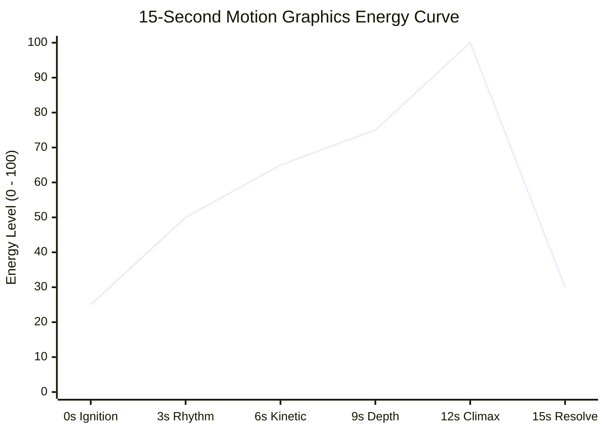

# Creative Direction, Pacing & Pacing Curves

Motion graphics succeed or fail on rhythm and tension. A showreel is an emotional roller-coaster, not a sequence of unrelated visual effects.

---

## 1. The 6-Stage Energy Arc

A compelling 15-second showreel follows a classic musical arc:

1. **Ignition (0.0 - 2.4s)**:
   - *Mood*: Curiosity $\to$ sudden spark.
   - *Technique*: Single point anticipation squash $\to$ explosive shockwaves $\to$ kinetic title drop.
2. **Rhythm & Bloom (2.4 - 5.2s)**:
   - *Mood*: Hypnotic flow.
   - *Technique*: Radial grid expansion, traveling harmonic sine waves, geometric polygon morphing.
3. **Kinetic Message (5.2 - 8.4s)**:
   - *Mood*: Confident, snappy editorial statements.
   - *Technique*: 1.05s beat cuts, skewed wipe panels, per-letter kerning tracking, HUD meta details.
4. **Depth & Physics (8.4 - 11.2s)**:
   - *Mood*: Spatial immersion, technical sophistication.
   - *Technique*: 3D orbital particle rings, perspective division, atmospheric fog, twisting ribbons.
5. **Climax Cuts (11.2 - 13.2s)**:
   - *Mood*: Peak sensory overload.
   - *Technique*: 4-frame hard cuts (7.5 Hz), strobe typography, radial manga speed lines, hazard stripes, camera shake.
6. **Brand Resolve (13.2 - 15.0s)**:
   - *Mood*: Clean exhale and lasting memory.
   - *Technique*: Iris wipe from chaos into deep navy, vector stroke reveal (trim paths), elastic core pop, title hold, and gentle fade to black.

---

## 2. Palette & Contrast Philosophy

- **Background**: Deep midnight navy `#0A0A12`. Never use pure `#000000` because pure black lacks depth.
- **Accents**: Neon Pink `#FF2E88`, Cyber Cyan `#00E5FF`, Electric Yellow `#FFD600`, Royal Violet `#7C4DFF`, Crisp White `#F5F5FA`.
- **Why**: Deep dark backgrounds maximize the dynamic range of additive bloom passes and chromatic aberration flares.
- **Restraint**: Limit each visual beat to 2-3 primary accent colors to maintain strong brand coherence.

---

## 3. Transition Vocabulary

Every scene exit must actively hand off kinetic energy to the subsequent entrance:

| Transition Type | Mechanics | Best Used For |
| :--- | :--- | :--- |
| **Punch-In Zoom** | Camera zoom ramps exponentially ($1 \to 1.15 \to \infty$) into next scene | Spatial continuity |
| **Glitch / Flash** | 2-frame white overlay + 16px chromatic aberration spike | High-energy cut boundaries |
| **Color Wipe Panel** | Skewed trapezoidal polygon wipes horizontally | Snappy editorial typography |
| **Iris Wipe** | Circle expands or contracts between scene backgrounds | Calming climax into resolve |
| **Track Matte Stencil**| Luminance mask wipes text from center outward | Geometric title reveals |
