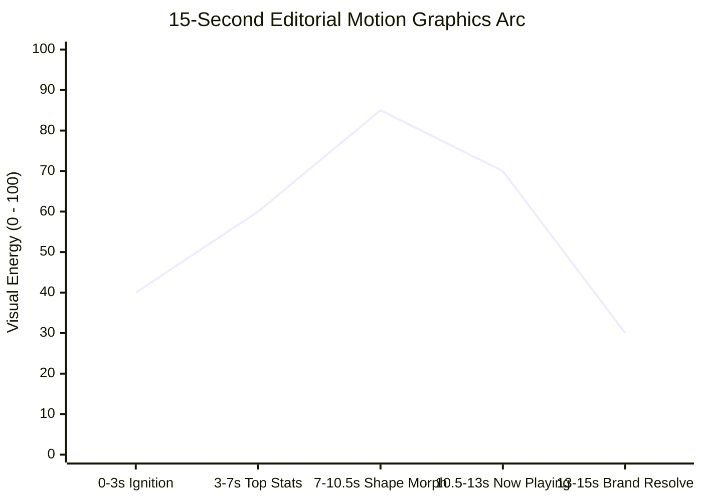

# Creative Direction, Pacing & Design Aesthetics

Motion graphics succeed or fail on rhythm, clarity, and art direction. Procedural motion in Python supports two distinct, broadcast-grade design pillars.

---

## 1. The Two Design Pillars

| Dimension | Pillar 1: Flat Editorial / "Wrapped" (Recommended) | Pillar 2: Dark Cyber Glow |
| :--- | :--- | :--- |
| **Aesthetic Inspiration** | Spotify Wrapped, Swiss Graphic Style, Bauhaus | Cyberpunk, Synthwave, Sci-Fi HUD |
| **Color Palette** | Bold, saturated solid color blocks per scene | Midnight navy (`#080812`) + neon accents |
| **Typography** | Massive condensed bold type + hard offset drop shadow | Chromatic faux 3D extrusion layers |
| **Motion Physics** | Damped harmonic springs, squash & stretch, contact shadows | Canned cubic easings, exponential snaps |
| **Post-Processing** | **None** (Pure SSAA vector rendering) | Bloom, chromatic aberration, film grain, vignette |
| **Transitions** | Seamless concurrent iris wipes, sliding mask stencils | Hard cuts with white flash + CA spikes |
| **Video File Size** | **~2.7 MB** (ultra-efficient compression) | **~48.8 MB** (noise kills compression) |

---

## 2. Pillar 1: Flat Editorial / "Spotify Wrapped" Motion

### 2.1 Color-Block Art Direction
Instead of one monotonous dark background, assign a distinctive, saturated brand color to every scene:
- **Scene A (Ignition)**: Spotify Green (`#1ED760`) with rotating sunburst rays and contrasting black accents.
- **Scene B (Stats / Rank)**: Rich Purple (`#8B3DFF`) with high-contrast white and pastel accent indicators.
- **Scene C (Playful Forms)**: Electric Orange (`#FF6437`) with shape bouncing and floor shadows.
- **Scene D (Product Player)**: Deep Cobalt Blue (`#2D46B9`) with spinning vinyl turntable and waveform scrubber.
- **Scene E (Resolve)**: Pitch Black (`#121212`) with iconic brand badge and crisp typography.

### 2.2 Hard Offset Drop Shadows
Instead of soft Gaussian drop shadows (which look blurry and dated), use sharp, hard offset vector duplicates:
```python
# Solid hard drop shadow shifted down-right (+8, +8)
pen.txt(x + 8, y + 8, "MOTION", size=180, fill=BLACK)
pen.txt(x, y, "MOTION", size=180, fill=WHITE)
```

### 2.3 UI & Product Motion Primitives
- **Stretching Pill Badges**: A pill container that springs open from center (`640 - 150*q` to `640 + 150*q`) and reveals a subtitle badge once near full expansion.
- **Ranked Countdown Cards**: Rounded track containers (1 to 5) with circular numerical badges, staggered spring entries, and animated percentage progress bars.
- **Spinning Vinyl Record**: Dark concentric groove rings, rotating light highlights (wedges) simulating real turntable light reflection, center label disc, and radiating sound ripples.
- **Real-Time Waveform Scrubber**: Audio vertical bars modulated by harmonic sine frequencies whose color fills up dynamically behind the playback playhead.

---

## 3. Pillar 2: Dark Cyber Glow Motion

When the creative brief explicitly requests a futuristic, neon, or cinematic sci-fi atmosphere:
- **Background**: Near-black (`#080812`) with subtle Lissajous radial gradient drifts.
- **Accents**: Neon Pink (`#FF2E88`), Cyber Cyan (`#00E5FF`), Electric Yellow (`#FFD600`).
- **Depth**: 3D particle clouds projected via Euler rotations and Painter's Algorithm.
- **Post-Processing**: Apply Gaussian bloom, chromatic aberration spikes, and subtle film grain.

---

## 4. Emotional Arc & Pacing (15-Second Blueprint)



1. **0.0 - 3.0s (Ignition)**: Two opposing headline words slam in from opposite screen edges using damped spring physics. Sunburst spins in the background. Pill badge pops open.
2. **3.0 - 7.0s (Rhythm / Stats)**: Five ranked skill cards slide in from the right with staggered spring timing ($0.22\text{s}$ offsets). Progress bars sweep open and percentage counters count up in sync.
3. **7.0 - 10.5s (Playful Physics)**: Geometric shapes bounce rhythmically across the screen, morphing mid-air between circle, square, triangle, and star. They squash upon impact with dynamic floor contact shadows.
4. **10.5 - 13.0s (Product / Now Playing)**: A vinyl record spins into view with realistic specular light glints. Dynamic audio waveform bars pulse to the beat.
5. **13.0 - 15.0s (Brand Resolve)**: Seamless iris wipe transition into solid black. Logo disc pops in with play button, followed by per-letter spring drop of the final call to action. Gentle fade to black.
