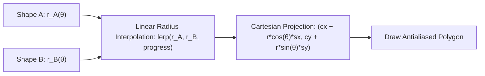

# 2D Polar Shape Morphing & UI Motion Design

This document details the mathematical formulation of 2D polar radius shape morphing and procedural UI motion primitives inspired by modern digital music experiences (e.g. Spotify Wrapped).

---

## 1. 2D Polar Radius Shape Morphing

In traditional vector animation software, morphing between arbitrary shapes often causes ugly vertex twisting and inverted topology. In pure code, we represent any 2D closed polygon as an analytical **polar radius function** $r(\theta) \in \mathbb{R}^+$ for $\theta \in [0, 2\pi)$.



### 1.1 Analytical Polar Radius Formulas

1. **Circle**:
   $$r_{\text{circle}}(\theta) = 1.0$$

2. **Square / Rounded Box**:
   $$r_{\text{square}}(\theta) = \frac{0.86}{\max(|\cos\theta|, |\sin\theta|)}$$

3. **Equilateral Triangle**:
   $$m = \left(\theta + \frac{\pi}{2}\right) \pmod{\frac{2\pi}{3}}$$
   $$r_{\text{triangle}}(\theta) = \frac{0.5 \cdot 1.15}{\max\left(0.1, \cos\left(m - \frac{\pi}{3}\right)\right)}$$

4. **5-Point Star**:
   $$r_{\text{star}}(\theta) = 0.62 + 0.38 \cos^2(5\theta) + 0.05$$

### 1.2 Python Implementation

```python
def polar_radius(shape_type: int, theta: float) -> float:
    if shape_type == 0:  # Circle
        return 1.0
    elif shape_type == 1:  # Square
        return 0.86 / max(abs(math.cos(theta)), abs(math.sin(theta)))
    elif shape_type == 2:  # Triangle
        m = (theta + math.pi / 2.0) % (2.0 * math.pi / 3.0)
        return 0.5 * 1.15 / max(0.1, math.cos(m - math.pi / 3.0))
    elif shape_type == 3:  # Star
        return 0.62 + 0.38 * (math.cos(5.0 * theta) ** 2) + 0.05
    return 1.0

def morph_polar_shapes(shape_a: int, shape_b: int, progress: float, num_samples: int = 72):
    pts = []
    for i in range(num_samples):
        th = i / num_samples * 2.0 * math.pi
        r = lerp(min(polar_radius(shape_a, th), 1.5), min(polar_radius(shape_b, th), 1.5), progress)
        pts.append((th, r))
    return pts
```

### 1.3 Combining with Squash & Stretch
To inject organic personality, project the interpolated polar points into Cartesian coordinates and multiply by squash & stretch scale factors $(s_x, s_y)$:

$$x_i = c_x + \cos(\theta_i) \cdot r_i \cdot s \cdot s_x$$
$$y_i = c_y + \sin(\theta_i) \cdot r_i \cdot s \cdot s_y$$

---

## 2. UI Motion Primitives

Procedural motion design is especially effective for showcasing digital products and interactive interfaces.

### 2.1 The Expanding Pill Badge
Used for intro greetings, category tags, or status indicators:
1. Initialize a pill of width $2 \cdot 150 \cdot q$ around center $x=640$, where $q = \text{spring}(\text{prog}(t, 0.9, 1.6))$.
2. Once $q > 0.85$, draw centered badge typography.

```python
q = spring(prog(t, 0.9, 1.6))
pen.rect(640 - 160 * q, 80, 640 + 160 * q, 140, BLACK, r=30)
if q > 0.85:
    pen.txt(640, 110, "HELLO, I'M YOUR NEXT HIRE", 22, GREEN)
```

### 2.2 Ranked Top-Tracks Card
Simulates year-in-review / ranked metric leaderboards:
- **Card Background**: Wide rounded rectangle sliding in horizontally via spring physics.
- **Rank Badge**: Circular colored disc containing rank number (1-5).
- **Metric Progress Track**: A muted background pill track with a colored foreground bar sweeping open via $\text{smoothstep}$.
- **Percentage Counter**: Synchronous text counter (`f"{int(f * 100)}%"`).

### 2.3 Turntable Vinyl Record with Light Glints
Recreates a spinning physical vinyl record in 2D vector code:
1. **Concentric Grooves**: 6-8 thin concentric circles with subtle dark gray stroke colors.
2. **Specular Light Highlights (Wedges)**: Two rotating triangular polygons ($\theta_{\text{rot}}$ and $\theta_{\text{rot}} + \pi$) rendered in faint specular gray (`#1E1E26`) simulating overhead light glinting off micro-grooves.
3. **Center Label Disc**: Saturated brand-colored circle with center spindle hole.
4. **Off-Center Text Label**: Small orbiting dot representing vinyl rotation.

```python
# Rotating highlights show spin
ang = t * 4.2
for a0 in (ang, ang + math.pi):
    pen.poly([(cx, cy),
              (cx + R * math.cos(a0), cy + R * math.sin(a0)),
              (cx + R * math.cos(a0 + 0.35), cy + R * math.sin(a0 + 0.35))], (30, 30, 38))
```

### 2.4 Dynamic Audio Waveform Scrubber
Combines audio player controls with dynamic visualization:
- Generate 30-50 vertical rounded bars.
- Modulate base heights using harmonic frequencies:
  $$h_i = h_{\min} + \Delta h \cdot |\sin(1.7 i) \cos(0.53 i + 1)|$$
- Behind the playback playhead ($i/N \le \text{progress}$), add an oscillating sine term and color the bars bright green.
- Ahead of the playhead, color bars in muted track color.
