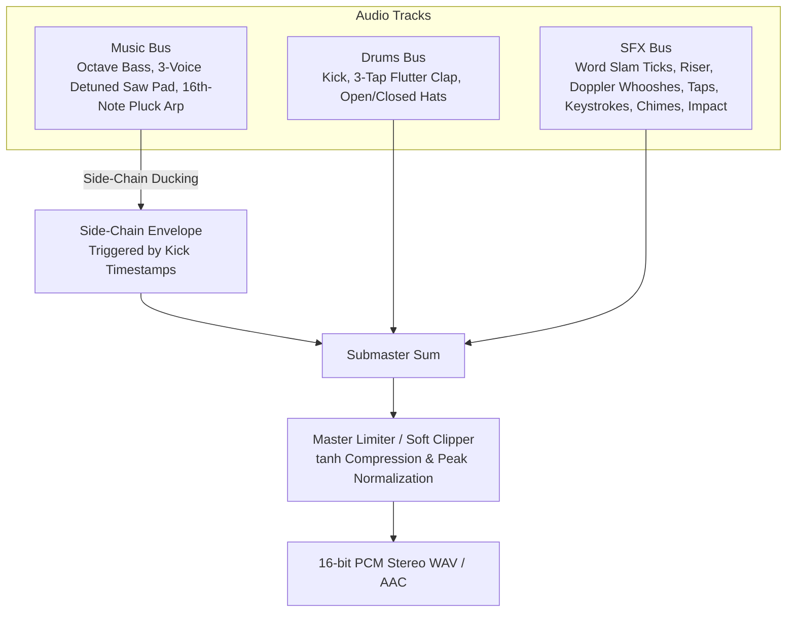

# Procedural Audio DSP & Sound Design in Pure Python

A broadcast-grade motion graphics video requires a soundtrack of equal quality. Relying on external audio files introduces license restrictions and synchronization drift. The V4 architecture synthesizes **100% procedural electronic soundtracks and frame-accurate UI Foley sound design** in pure Python using NumPy and SciPy.

Every musical element, transition whoosh, and touch click is mathematically aligned with the video timeline.



---

## 1. Audio Engine Evolution: V1 $\to$ V2 $\to$ V3 $\to$ V4

| Version | Synthesizer Architecture | Harmonic Structure & Key | Filter Pipeline | Dynamic Processing | Foley Sound Design |
| :--- | :--- | :--- | :--- | :--- | :--- |
| **V1 (`X ad 1`)** | Dual mono NumPy arrays summed to stereo | Low atmospheric drone (D1/A1/D2) + bass synth sequence | No digital filters (raw sine harmonics & unfiltered white noise) | No ducking (kick clutters drone and bass) | Basic telemetry ticks, no UI interaction sounds |
| **V2 (`X ad 2`)** | Stereo buffer with SciPy SOS integration | 120 BPM beat with detuned saw pad | SciPy Butterworth 2-pole SOS lowpass & bandpass filters | Kick-triggered sidechain ducking envelope | Initial UI Foley (taps, heart pop, keystrokes, chimes, boom) |
| **V3 (`X ad 3`)** | Compact inline mono generator in `make_x_ad.py` | 120 BPM, 4 chords using `np.sign` and `np.sin` | No digital filters (basic arithmetic envelopes) | Basic overall soft clipping | Simplified whoosh cuts only; stripped all UI micro-interaction Foley |
| **V4 (`X ad 4` - Golden Standard)** | Modular stereo DSP engine (`x_ad_audio.py`) | 120 BPM, 4-bar progression in A minor (`Am - F - C - G`) with octave bass & 16th-note pluck arpeggiator | SciPy Butterworth SOS with dynamic lowpass sweep ($700\text{Hz} \to 2400\text{Hz}$) + dual-band Doppler whooshes | Exponential kick sidechain ducking ($1 - 0.55e^{-9t}$) + master tanh limiter to $-1\text{ dBFS}$ | Comprehensive frame-accurate Foley catalog: word slam ticks, 1s tension riser, tap clicks, heart pop chirp ($520 \to 1620\text{Hz}$), typing jitter, send swoosh, triad + octave notification chimes, sub-drop impact crash |

---

## 2. Timeline, Beat Grid & Progressive 5-Act Arrangement

Align musical tempo directly with frame rates:
- **120 BPM** translates to exactly $0.50\text{s}$ per beat ($15\text{ frames}$ at 30 FPS).
- A 16th-note equals $0.125\text{s}$ ($3.75\text{ frames}$).
- Aligning the first beat offset (`OFF = 0.05s`) guarantees that visual kinetic word slams land precisely on downbeats.

### Progressive Arrangement Across the 5 Acts
Never use a static loop across all 15 seconds. Evolve the instrumentation across the 5 acts to mirror visual intensity:
1. **Act 1 (`0.00 - 3.05s` — Hook)**: Dark lowpass-filtered pad (`cutoff = 700 Hz`) + four-on-the-floor kick + downbeat word-slam ticks (`0.05, 0.55, 1.05, 1.55s`) + clap & open hat at `2.05s` + 1.0s tension `riser()` (`2.05 -> 3.05s`).
2. **Act 2 (`3.05 - 7.55s` — Feed)**: Filter opens up (`cutoff = 2400 Hz`), open hat drop at `3.05s`, clap on beats 2 & 4, offbeat closed hats (`bt + 0.25s`), and octave-jumping 8th-note `bass_note(root * (1 if e == 0 else 2))`.
3. **Act 3 (`7.55 - 10.05s` — Compose)**: Adds 16th-note syncopated hi-hats (`bt + 0.125s`, `bt + 0.375s`) AND a **stereo-panned 16th-note `pluck()` arpeggiator** (`pan = -0.5 if s % 2 == 0 else 0.5`) that drives urgency while characters are being typed.
4. **Act 4 (`10.05 - 12.05s` — Reaction)**: Full groove continues underneath ascending harmonic triad + octave notification chimes (`659.25 Hz`, `783.99 Hz`, `880.0 Hz` + `2x` octave shimmer delayed by `60ms`).
5. **Act 5 (`12.05 - 15.00s` — End Card)**: Drums stop on a massive `kick(big=True)` + 2.6s `impact()` sub-drop crash at `12.05s`, sustained warm A-minor pad (`cutoff = 2000 Hz`), 3-note ascending A-minor `pluck` sting (`440, 659.25, 880 Hz`), and final CTA tap + harmonic chimes (`880 Hz` + `1318.5 Hz`) at `13.75s`.

---

## 3. Instrument Synthesis Palette

### 3.1 Electronic Kick Drum (`kick`)
Combines an exponential pitch envelope dropping from $160\text{Hz}$ to $44\text{Hz}$, a sub-bass sine body, and a high-pass filtered transient click:

```python
def kick(big=False):
    t = tt(0.9 if big else 0.45)
    f = 44 + (150 if big else 115) * np.exp(-t * 26)
    ph = 2 * np.pi * np.cumsum(f) / SR
    body = np.sin(ph) * np.exp(-t * (3.5 if big else 7.5))
    click = filt(noise(len(t) / SR), "highpass", 2500) * np.exp(-t * 400) * 0.25
    return np.tanh((body + click) * 1.6) * 0.9
```

### 3.2 Handclap with 3-Tap Micro-Flutter (`clap`)
Authentic claps consist of three micro-bursts ($0\text{ms}, 11\text{ms}, 23\text{ms}$) simulating multiple hands clapping together, plus a $185\text{Hz}$ resonant body:

```python
def clap():
    t = tt(0.35)
    n = filt(noise(0.35), "bandpass", [900, 6000])
    env = np.zeros_like(t)
    for d in (0.0, 0.011, 0.023):
        env += np.where(t >= d, np.exp(-(t - d) * 55), 0) * 0.5
    env += np.exp(-t * 14) * 0.6
    body = np.sin(2 * np.pi * 185 * t) * np.exp(-t * 35) * 0.3
    return n * env * 0.35 + body
```

### 3.3 3-Voice Unison Detuned Saw Pad, Octave Bass & 16th-Note Pluck Arp
Layering 12-harmonic band-limited sawtooth waves with 3-voice semitone detune (`-0.12, 0.0, +0.11` semitones) creates a lush analog pad, while `pluck()` drives Act 3:

```python
def saw(f, t, harmonics=10):
    out = np.zeros_like(t)
    for k in range(1, harmonics + 1):
        if f * k > 9000:
            break
        out += np.sin(2 * np.pi * f * k * t) / k
    return out * 0.6

def pad_chord(freqs, dur, cutoff):
    t = tt(dur)
    sig = np.zeros_like(t)
    for f in freqs:
        for det in (-0.12, 0.0, 0.11):
            sig += saw(f * 2 ** (det / 12), t, 12)
    sig = filt(sig, "lowpass", cutoff)
    env = np.minimum(1, t / 0.25) * np.minimum(1, (dur - t) / 0.25)
    return sig * env * 0.07

def pluck(f, dur=0.25):
    t = tt(dur)
    sig = filt(saw(f, t, 14), "lowpass", 3800)
    return sig * np.exp(-t * 11) * np.minimum(1, t / 0.002) * 0.35
```

### 3.4 Tension Riser & Doppler Dual-Band Whoosh (`riser` & `whoosh`)
Cross-interpolating between a low bandpass filter (`[lo, 0.4*hi]`) and a high bandpass filter (`[3*lo, hi]`) creates a realistic Doppler frequency sweep during screen transitions:

```python
def riser(dur):
    t = tt(dur)
    x = t / dur
    n = filt(noise(dur), "bandpass", [600, 7000]) * x ** 2.2 * 0.35
    f = 220 + 1200 * x ** 2
    tone = np.sin(2 * np.pi * np.cumsum(f) / SR) * x ** 2 * 0.08
    return n + tone

def whoosh(dur=0.45, lo=300, hi=5000):
    t = tt(dur)
    x = t / dur
    n = noise(dur)
    a = filt(n, "bandpass", [lo, hi * 0.4])
    b = filt(n, "bandpass", [lo * 3, hi])
    sig = a * (1 - x) + b * x
    return sig * np.sin(np.pi * x) ** 2 * 0.45
```

---

## 4. Real-Time Side-Chain Compression (Ducking)

To achieve modern punch where synth pads, bass, and plucks breathe around the kick drum, apply an exponential ducking curve across the entire `music` bus on every kick timestamp:

```python
t = np.arange(N) / SR
duck = np.ones(N)
for kt in kick_times:
    m = t >= kt
    duck[m] = np.minimum(duck[m], 1 - 0.55 * np.exp(-(t[m] - kt) * 9))
music *= duck[:, None]
```

---

## 5. Frame-Accurate UI Foley Sound Design

| UI Event | Synthesis Technique | Frequency & Envelope |
| :--- | :--- | :--- |
| **Touch Tap (`tap_sfx`)** | High-sine pulse + highpass noise click | $1900\text{Hz}$ sine ($\tau = 11\text{ms}$) + $3000\text{Hz}$ highpass click. |
| **Heart Pop (`pop_sfx`)** | Pitch-bend sine bubble | Ramps $520\text{Hz} \to 1620\text{Hz}$ over $50\text{ms}$ ($\tau = 38\text{ms}$). |
| **Keystroke Ticks (`tick_sfx`)** | Bandpass noise clicks with stereo pan jitter | $1800 - 7000\text{Hz}$ bandpass, $\pm 0.3$ random stereo pan. |
| **Post Send (`send_sfx`)** | Exponential frequency rise + wide whoosh | Sweeps $400\text{Hz} \to 2200\text{Hz}$ over $0.3\text{s}$ + `whoosh(0.3, 800, 8000)`. |
| **Notification Chimes (`chime`)** | Fundamental + $2\times$ + $3.01\times$ inharmonic bell + octave echo | $E_5 (659\text{Hz})$, $G_5 (784\text{Hz})$, $A_5 (880\text{Hz})$ + octave chime $+60\text{ms}$ later. |
| **Monumental Impact (`impact`)** | Sub-drop + highpass crash + lowpass body | $48\text{Hz}$ sub sine + $3500\text{Hz}$ crash + $900\text{Hz}$ body decaying over $2.6\text{s}$. |
