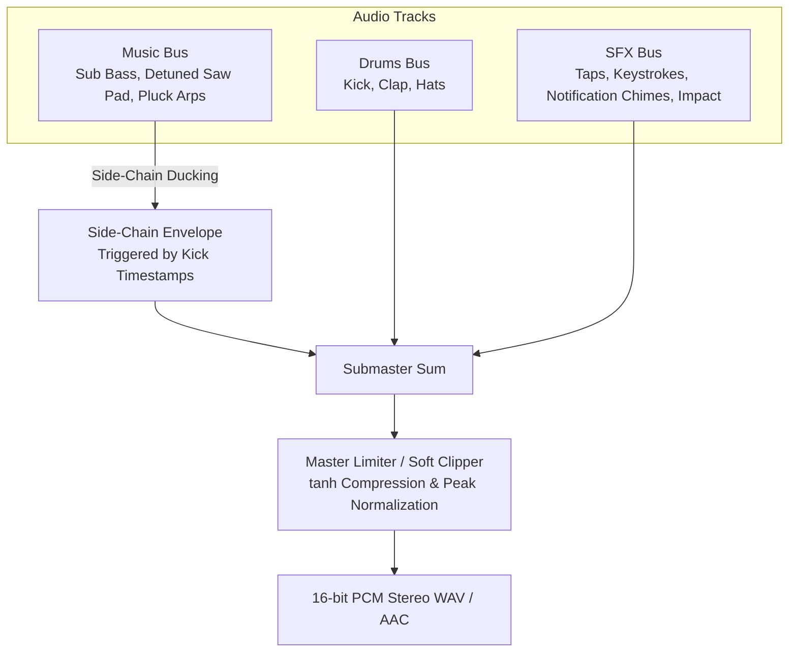

# Procedural Audio DSP & Sound Design in Pure Python

A broadcast-grade motion graphics video requires a soundtrack of equal quality. Relying on external audio files introduces license restrictions and synchronization drift. The V4 architecture synthesizes **100% procedural electronic soundtracks and frame-accurate UI Foley sound design** in pure Python using NumPy and SciPy.

Every musical element, transition whoosh, and touch click is mathematically aligned with the video timeline.



---

## 1. Timeline & Grid Synchronization

Align musical tempo directly with frame rates:
- **120 BPM** translates to exactly $0.50\text{s}$ per beat ($15\text{ frames}$ at 30 FPS).
- A 16th-note equals $0.125\text{s}$ ($3.75\text{ frames}$).
- Aligning the first beat offset (`OFF = 0.05s`) guarantees that visual kinetic word slams land precisely on downbeats.

```python
SR = 44100
DUR = 15.0
N = int(SR * DUR)
BEAT = 0.50          # 120 BPM
OFF = 0.05           # Initial beat alignment offset
```

---

## 2. DSP Filtering with SciPy Butterworth SOS

Raw synthesized noise or naive waveforms sound harsh. V4 uses **Second-Order Sections (SOS) Butterworth digital filters** (`scipy.signal.butter` and `sosfilt`) for warm, analog-like frequency shaping:

```python
from scipy.signal import butter, sosfilt

def filt(x: np.ndarray, kind: str, f: Union[float, list]) -> np.ndarray:
    """Apply zero-phase second-order section Butterworth filter."""
    sos = butter(2, f, btype=kind, fs=SR, output="sos")
    return sosfilt(sos, x)
```

---

## 3. Instrument Synthesis Palette

### 3.1 Electronic Kick Drum
A punchy kick combines an exponential pitch envelope dropping from $160\text{Hz}$ to $44\text{Hz}$, a sub-bass sine body, and a high-pass filtered transient click:

```python
def kick(big=False):
    t = np.arange(int((0.9 if big else 0.45) * SR)) / SR
    # Exponential pitch envelope
    f = 44 + (150 if big else 115) * np.exp(-t * 26)
    phase = 2 * np.pi * np.cumsum(f) / SR
    body = np.sin(phase) * np.exp(-t * (3.5 if big else 7.5))
    # High-pass click transient
    click = filt(np.random.standard_normal(len(t)), "highpass", 2500) * np.exp(-t * 400) * 0.25
    return np.tanh((body + click) * 1.6) * 0.9
```

### 3.2 Handclap with Multi-Tap Flutter
Authentic claps are not single noise bursts. They consist of multiple micro-bursts ($0\text{ms}, 11\text{ms}, 23\text{ms}$) simulating multiple hands making contact:

```python
def clap():
    t = np.arange(int(0.35 * SR)) / SR
    noise = filt(np.random.standard_normal(len(t)), "bandpass", [900, 6000])
    env = np.zeros_like(t)
    for d in (0.0, 0.011, 0.023):
        env += np.where(t >= d, np.exp(-(t - d) * 55), 0) * 0.5
    env += np.exp(-t * 14) * 0.6
    body = np.sin(2 * np.pi * 185 * t) * np.exp(-t * 35) * 0.3
    return noise * env * 0.35 + body
```

### 3.3 Rich Detuned Saw Pad & Lowpass Sweeps
Layering slightly detuned sawtooth waves creates a lush analog pad. Sweeping the filter cutoff from $700\text{Hz}$ (dark during Hook) to $2400\text{Hz}$ (bright during Feed) creates natural dynamic build:

```python
def saw(f, t, harmonics=10):
    out = np.zeros_like(t)
    for k in range(1, harmonics + 1):
        if f * k > 9000: break
        out += np.sin(2 * np.pi * f * k * t) / k
    return out * 0.6

def pad_chord(freqs, dur, cutoff):
    t = np.arange(int(dur * SR)) / SR
    sig = np.zeros_like(t)
    for f in freqs:
        for det in (-0.12, 0.0, 0.11):
            sig += saw(f * 2 ** (det / 12), t, 12)
    sig = filt(sig, "lowpass", cutoff)
    env = np.minimum(1, t / 0.25) * np.minimum(1, (dur - t) / 0.25)
    return sig * env * 0.07
```

---

## 4. Real-Time Side-Chain Compression (Ducking)

To achieve that signature modern punch where synth pads and bass breathe around the kick drum, apply an exponential ducking curve across the music bus on every kick timestamp:

```python
def apply_sidechain(music: np.ndarray, kick_times: list):
    t = np.arange(len(music)) / SR
    duck = np.ones(len(music))
    for kt in kick_times:
        mask = t >= kt
        duck[mask] = np.minimum(duck[mask], 1.0 - 0.55 * np.exp(-(t[mask] - kt) * 9.0))
    return music * duck[:, None]
```

---

## 5. Frame-Accurate UI Foley Sound Design

Micro-interactions without synchronized audio feel lifeless. V4 introduces specialized procedural SFX algorithms:

| UI Event | Synthesis Technique | Frequency & Envelope |
| :--- | :--- | :--- |
| **Touch Tap** | High-sine pulse + filtered noise click | $1900\text{Hz}$ sine, $\tau = 11\text{ms}$, click at $3000\text{Hz}$. |
| **Heart Pop** | Pitch-bend sine bubble | Ramps from $520\text{Hz}$ to $1620\text{Hz}$ over $50\text{ms}$. |
| **Keystroke Ticks** | Bandpass noise clicks with subtle timing jitter | $1800 - 7000\text{Hz}$ bandpass, $\pm 0.3$ stereo pan. |
| **Post Send Whoosh** | Exponential frequency rise + wide noise sweep | Sweeps $400\text{Hz} \to 2200\text{Hz}$ over $0.3\text{s}$. |
| **Notification Chimes** | Resonant harmonic bells | Fundamental $E_5 (659\text{Hz})$, $G_5 (784\text{Hz})$, $A_5 (880\text{Hz})$ with $2\times$ and $3\times$ overtone decay. |
| **Monumental Impact** | Deep sub-drop + highpass crash + resonant body | $48\text{Hz}$ sub sine $+ 3500\text{Hz}$ white noise burst decaying over $2.6\text{s}$. |

### Example: Procedural Notification Chime
```python
def chime(freq: float, dur: float = 0.9) -> np.ndarray:
    t = np.arange(int(dur * SR)) / SR
    sig = (np.sin(2 * np.pi * freq * t)
           + 0.35 * np.sin(2 * np.pi * 2 * freq * t)
           + 0.12 * np.sin(2 * np.pi * 3.01 * freq * t))
    return sig * np.exp(-t * 5.5) * np.minimum(1, t / 0.003) * 0.22
```

---

## 6. Stereo Mastering & Limiting Pipeline

Before rendering the audio file:
1. **Sum Buses**: Blend music, drums, and SFX with calibrated relative gains.
2. **Soft Clipping**: Pass the mix through an analog-modeled `np.tanh` curve to prevent harsh digital clipping while imparting harmonic warmth.
3. **Peak Normalization**: Scale the output to $-1\text{ dBFS}$ ($0.89$ peak amplitude) to guarantee headroom across streaming codecs.
4. **Anti-Click Fades**: Apply a $10\text{ms}$ fade-in at start and a smooth $0.5\text{s}$ exponential fade-out at the end.

```python
mix = music * 0.90 + drums * 0.80 + sfx * 0.90
mix = np.tanh(mix * 1.3) / np.tanh(1.3)
mix /= np.max(np.abs(mix)) + 1e-9
mix *= 0.89  # -1 dBFS standard

# Export 16-bit PCM WAV
pcm = (mix * 32767).astype(np.int16)
with wave.open("soundtrack.wav", "wb") as w:
    w.setnchannels(2)
    w.setsampwidth(2)
    w.setframerate(44100)
    w.writeframes(pcm.tobytes())
```
