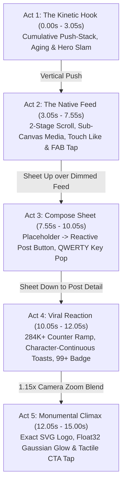
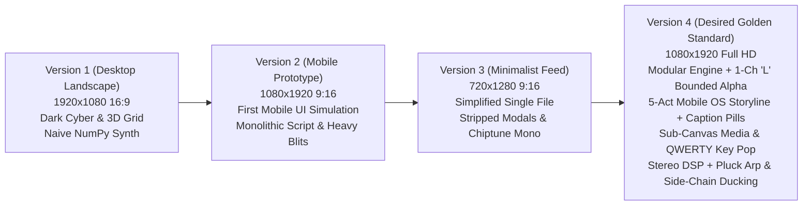

# Vertical Mobile Ad & Product Simulation Architecture (V4 Desired Framework)

The transition from landscape desktop showcases to **Full HD Vertical Video (1080x1920 @ 30 FPS)** represents the current pinnacle in procedural motion design. Modern audience attention is captured on vertical mobile surfaces (TikTok, Instagram Reels, YouTube Shorts, X Timeline). Simulating an authentic mobile operating system session with native touch gestures, feed scrolling, interactive typing modals, and notification explosions creates unparalleled viewer engagement.



---

## 1. Architectural Evolution: V1 vs V2 vs V3 vs V4 (Why V4 is the Desired Golden Standard)

The procedural motion engine evolved through four distinct architectural paradigms before establishing Version 4 as the golden standard for broadcast-grade mobile ads:



### Detailed Evolution Matrix

| Engineering Dimension | Version 1 (`X ad 1`) | Version 2 (`X ad 2`) | Version 3 (`X ad 3`) | Version 4 (`X ad 4` - Desired Golden Standard) |
| :--- | :--- | :--- | :--- | :--- |
| **Target Platform** | Desktop / TV Landscape ($1920\times 1080$, 16:9) | Mobile Vertical ($1080\times 1920$, 9:16) | Mobile Vertical ($720\times 1280$, 9:16) | **Full-HD Mobile Vertical ($1080\times 1920$, 9:16)** |
| **Visual World & Narrative** | Dark Cyber sci-fi space: 3D wireframe vanishing grid, drifting particle dust, 3 static horizontal cards side-by-side | Mobile app simulation prototype: SpaceX telemetry box, Elon post, modal compose, viral analytics card | Minimalist flat feed: stripped down text-only posts, kinetic cards cycling, simple end button | **Surgical minimalism on pure `#000000` black + hyper-authentic native mobile OS screens guided by floating `caption()` pills** |
| **Anti-Aliasing (AA)** | $1\times$ native rasterization (visible pixel stepping on diagonals & text) | $1.5\times$ SSAA Lanczos downsampling ($1620\times 2880$ virtual canvas), 4-channel RGBA blits | $1.5\times$ SSAA Lanczos downsampling ($1080\times 1920$ virtual canvas) | **$1.5\times$ SSAA Lanczos + 1-Channel `"L"` Bounded Alpha Blitting (`_alpha`) + `paste_rounded`** |
| **Blitting & Performance** | Sequential single-threaded rendering | Monolithic single-threaded, full-frame alpha blitting (high memory & CPU overhead) | Compact single-threaded loop | **Multiprocessing pool (`multiprocessing.Pool`), chunked pipes to ffmpeg, fast `--preview` CLI** |
| **Typography & Layout** | Hardcoded text boxes, rigid desktop layout | Hardcoded text positions, static card bounding boxes | Basic programmatic word wrap (`wrap`) | **Dynamic word wrap (`wrap`), automated height calculation (`layout_post`), adaptive font sizing (`fit_size`), inline width measurement (`tw`)** |
| **Feed Media Fidelity** | Static 2D cards side-by-side | Static SpaceX telemetry text box | Text-only posts (no media cards) | **Three isolated sub-canvas animated media cards (`vgrad` + `paste_rounded`): (1) Rocket launch with smoke/flames, (2) Soccer scoreboard with confetti, (3) Sunset shimmer** |
| **Micro-Interactions** | None (pure motion graphic) | Basic touch tap indicator, heart scale pop, button 8% depression | Simplified heart pop, outline button ripple | **Touch tap indicator (pad + compression + ripple), QWERTY key pop magnification, 8-particle burst on like, tactile CTA click** |
| **Modal & Keyboard** | None | Slide-up compose modal, static keyboard base | None (removed completely) | **Modal `sheet_up` transition over dimmed feed, `"What's happening?"` placeholder $\to$ reactive `"Post"` button, circular character ring, full QWERTY keyboard with spring key pop-up** |
| **Transitions** | Horizontal slide & warp streak tunnel cut | Single vertical push between Act 1 & 2; abrupt scene cuts elsewhere | Hard flash cuts (white blend on cut timestamps) | **Compositor-level transition suite (`apply_transition`): `push`, `sheet_up`, `sheet_down`, `zoom`** |
| **Audio Engine** | Naive NumPy synth: ambient drone, simple kick/hat/bass, no filters | SciPy Butterworth SOS filters, 120 BPM beat, sidechain ducking | Minimal mono audio in same file: `np.sign` chords, no SciPy filters, no Foley | **Stereo 120 BPM DSP in A minor: 3-voice detuned 12-harmonic `saw` pad (`700->2400Hz`), `riser`, flutter `clap`, 8th-note bass, 16th-note `pluck` arp, kick sidechain ducking, UI Foley** |
| **Code Structure** | Monolithic 683-line script + 189-line audio | Monolithic 840-line script + 303-line audio | Monolithic 232-line single script | **Clean modular separation: `x_ad.py` (visual engine) + `x_ad_audio.py` (DSP audio) + `motion_engine.py` (shared math)** |

---

## 2. The 5-Act Mobile Narrative Arc & Floating Caption System

In a 15-second commercial, every frame must serve a narrative purpose. The **Hook-Feed-Compose-React-End** architecture structures pacing for maximum retention, while a reusable **floating pill caption (`caption()`)** translates raw UI actions into marketing value:

```python
def caption(c: Canvas, cx: float, cy: float, text: str, lt: float,
            t_in: float, t_out: float = None, size: float = 58,
            fill=(29, 155, 240), tcol=(255, 255, 255)):
    """Renders a high-contrast commercial copy pill with spring overshoot entry and smooth exit."""
    e = ease_out_back(prog(lt, t_in, t_in + 0.4), 2.2)
    if t_out is not None:
        e *= 1.0 - ease_in_out_cubic(prog(lt, t_out, t_out + 0.22))
    if e <= 0.03:
        return
    w_ = tw(text, size, "black")
    pw, ph = (w_ + 90) * e, size * 1.85 * e
    c.rect(cx - pw / 2, cy - ph / 2, cx + pw / 2, cy + ph / 2, fill=fill, r=ph / 2)
    c.txt(cx, cy - size * 0.06 * e, text, size * e, tcol, "mm", "black")
```

### Act-by-Act Mechanics

| Act | Time Window | Scene Purpose | Key Mathematical & Visual Mechanics |
| :--- | :--- | :--- | :--- |
| **Act 1: The Hook** | $0.00\text{s} - 3.05\text{s}$ | Stop the scroll; build rhythmic momentum. | Centered X logo (`y=200`) + `"Happening now"` pill (`y=318`). `HOOK` stack with 4 phrases (`0.05, 0.55, 1.05, 1.55s`) spawning at `base_y = 1020`, pushing prior lines up by `LHH = 178px`, aging prior lines to `(58, 61, 64)`, showing blue trending meta only on the newest line, and flushing all lines upward (`exit_k`) at `2.05s` for the 2-line slam `"It's all"` / `"happening."` + underline sweep. |
| **Act 2: The Feed** | $3.05\text{s} - 7.55\text{s}$ | Immerse viewer in authentic timeline experience. | 5 dynamically wrapped posts (`layout_post`), live incrementing counters (`vals = stats + rate * lt`), 2-stage scroll (`SCROLL1` centers `Maya Chen`'s text post for the `LIKE_T = 1.95s` tap + 8-particle burst; `SCROLL2` reveals `Goal Line` soccer score & `Daily Frame` sunset), floating caption `"See it first."` (`0.6s - 2.3s`), and FAB tap at `3.85s`. |
| **Act 3: Compose** | $7.55\text{s} - 10.05\text{s}$ | Put the viewer in the creator's seat. | `sheet_up` transition over dimmed Act 2 feed. Shows `"What's happening?"` placeholder and dark disabled `"Post"` button `(14, 72, 112)` until `0.45s`, then illuminates `"Post"` to `#1D9BF0` as `"Hello, X. What's everyone talking about?"` types in with QWERTY key pop magnification, circular character arc, and floating caption `"Say it your way."` (`0.4s - 1.85s`). |
| **Act 4: Reaction** | $10.05\text{s} - 12.05\text{s}$ | Deliver immediate viral validation & continuity. | `sheet_down` transition into native `<- Post` detail view. Exponential counter ramp (`284K Views`, `1.8K Reposts`, `128 Quotes`, `12.4K Likes`), 10 translucent hearts drifting 180px up from the heart icon, 3 sliding toasts (`Maya Chen`, `Goal Line`, `86 new followers`), floating caption `"Get heard."` (`0.9s+`), and bottom-nav bell badge climbing `3 -> 99+`. |
| **Act 5: Climax & CTA** | $12.05\text{s} - 15.00\text{s}$ | Cement brand permanence & conversion. | `zoom` transition (`1.0 -> 1.15x` blend) into pure `#000000` canvas with continuous 2D Gaussian `float32` `glow_map()`. Exact 12-vertex `xlogo` (`300px`) with dual shockwave rings, `"Join the conversation."`, white `"Get the app"` pill button depressed 8% by a touch tap at `(640, 1300)` at `lt = 1.7s`, and `"x.com"`. |

---

## 3. Act 1 Push-Stack & Aging Mathematics (`scene_hook`)

Never lay out kinetic hook lines at static Y coordinates like a poster. Instead, spawn each line at the same focal baseline (`base_y = 1020`) and let each subsequent entry physically push older lines upward while dimming their brightness:

```python
HOOK = [("Breaking news.", "Trending worldwide · 1.2M posts"),
        ("Live sports.", "Sports · Trending · 482K posts"),
        ("Hot takes.", "Trending in Tech · 96K posts"),
        ("Big ideas.", "Science · Trending · 58K posts")]
HOOK_T = [0.05, 0.55, 1.05, 1.55]
FINAL_T = 2.05

exit_k = ease_in_out_cubic(prog(t, FINAL_T - 0.08, FINAL_T + 0.25))
LHH, base_y = 178, 1020
for i, (line, meta) in enumerate(HOOK):
    if t < HOOK_T[i]:
        continue
    e = ease_out_cubic(prog(t, HOOK_T[i], HOOK_T[i] + 0.26))
    pushes = sum(ease_out_cubic(prog(t, HOOK_T[j], HOOK_T[j] + 0.26)) for j in range(i + 1, len(HOOK)))
    y = base_y + (1 - e) * 110 - pushes * LHH - exit_k * 620
    age = clamp(pushes)
    col = lerpc(BLACK, WHITE, e)
    col = lerpc(col, (58, 61, 64), age)     # Older lines recede into dark grey
    col = lerpc(col, BLACK, exit_k)         # All lines fade out during upward flush
    c.txt(80, y, line, HOOK_SIZE, col, "lm", "black")
    # Sub-label appears ONLY on the newest active line (fades as soon as pushes > 0)
    mk = e * max(0.0, 1.0 - pushes * 3.5) * (1 - exit_k)
    if mk > 0.01:
        c.ell(92, y + 96, 7, fill=lerpc(BLACK, BLUE, mk))
        c.txt(112, y + 94, meta, 34, lerpc(BLACK, BLUE, mk), "lm", "semibold")
```

---

## 4. Super-Sampled Anti-Aliasing (SSAA), 1-Channel `_alpha` & `paste_rounded`

At $1080 \times 1920$, rendering diagonal lines, serrated badges, and fine typography at $1\times$ causes visible raster stair-stepping. The V4 architecture renders to a virtual canvas multiplied by scale factor $K = 1.5$ ($1620 \times 2880$) and downsamples with Lanczos filtering.

### 4.1 High-Performance 1-Channel `"L"` Bounded Alpha Blitting
Allocating full-screen or 4-channel `RGBA` buffers for translucent shapes wastes memory and CPU bandwidth. Always allocate a **1-channel grayscale mask (`"L"`)** bounded strictly to the shape's coordinates and pass the RGB color tuple directly to `self.im.paste(color, bbox, mask)`:

```python
def _alpha(self, x0, y0, x1, y1, color, a, draw_fn):
    a = clamp(a)
    if a <= 0:
        return
    X0, Y0 = max(0, int(math.floor(x0 * self.k)) - 2), max(0, int(math.floor(y0 * self.k)) - 2)
    X1, Y1 = min(self.im.size[0], int(math.ceil(x1 * self.k)) + 2), min(self.im.size[1], int(math.ceil(y1 * self.k)) + 2)
    if X1 <= X0 or Y1 <= Y0:
        return
    m = Image.new("L", (X1 - X0, Y1 - Y0), 0)
    draw_fn(ImageDraw.Draw(m), X0, Y0, int(255 * a))
    self.im.paste(color, (X0, Y0, X1, Y1), m)
```

### 4.2 Sub-Canvas Media Rendering with `vgrad` and `paste_rounded`
Complex animated media inside timeline cards (`media_rocket`, `media_score`, `media_sunset`) must be rendered on an isolated sub-canvas (`Canvas(w=870, h=470)`) with smooth NumPy vertical gradients (`vgrad`) and pasted via a rounded-rectangle mask (`paste_rounded`) so particles, smoke, and stars never bleed outside the card's rounded corners:

```python
def vgrad(c: Canvas, stops):
    """Fill a canvas with a vertical multi-stop gradient: stops=[(pos, color), ...]."""
    hpx, wpx = c.im.size[1], c.im.size[0]
    y = np.linspace(0, 1, hpx)
    cols = np.zeros((hpx, 3), np.float32)
    for ch in range(3):
        cols[:, ch] = np.interp(y, [s[0] for s in stops], [s[1][ch] for s in stops])
    arr = np.repeat(cols[:, None, :], wpx, axis=1).astype(np.uint8)
    c.im.paste(Image.fromarray(arr))

def paste_rounded(self, sub: Canvas, x0: float, y0: float, r: float):
    m = Image.new("L", sub.im.size, 0)
    ImageDraw.Draw(m).rounded_rectangle([0, 0, sub.im.size[0] - 1, sub.im.size[1] - 1],
                                        radius=r * self.k, fill=255)
    self.im.paste(sub.im, (int(x0 * self.k), int(y0 * self.k)), m)
```

---

## 5. Compositor-Level Screen Navigation Transitions (`apply_transition`)

Mobile UX obeys strict spatial hierarchies. Instead of mixing transition math into scene functions, keep each scene function pure (`scene_fn(lt)`) and apply transitions in `frame_at(t)` over the actual `PIL.Image` buffers of the current and previous scenes:

```python
SCENES = [(0.0, scene_hook), (3.05, scene_feed), (7.55, scene_compose),
          (10.05, scene_reaction), (12.05, scene_end)]
TRANS = [None, ("push", 0.45), ("sheet_up", 0.40), ("sheet_down", 0.40), ("zoom", 0.35)]

def dim(img: Image.Image, k: float) -> Image.Image:
    return img if k <= 0 else Image.blend(img, Image.new("RGB", img.size, (0, 0, 0)), clamp(k))

def apply_transition(kind: str, cur: Image.Image, prev: Image.Image, p: float) -> Image.Image:
    if kind == "push":
        return vertical_push_transition(cur, prev, p)
    if kind == "sheet_up":
        base = dim(prev, 0.6 * p)
        y_off = int((1 - ease_out_cubic(p)) * (H - 100))
        base.paste(cur.crop((0, 100, W, H)), (0, 100 + y_off))
        c_top = Canvas(w=W, h=100)
        status_bar(c_top)
        base.paste(c_top.im.resize((W, 100), Image.LANCZOS), (0, 0))
        return base
    if kind == "sheet_down":
        base = cur.copy()
        y_off = int(ease_in_out_cubic(p) * (H - 100))
        if y_off < (H - 100):
            base.paste(dim(prev, 0.4 * p).crop((0, 100, W, H)), (0, y_off + 100))
        c_top = Canvas(w=W, h=100)
        status_bar(c_top)
        base.paste(c_top.im.resize((W, 100), Image.LANCZOS), (0, 0))
        return base
    if kind == "zoom":
        z = 1 + 0.15 * ease_in_out_cubic(p)
        nw, nh = int(W * z), int(H * z)
        pz = prev.resize((nw, nh), Image.BICUBIC).crop(((nw - W) // 2, (nh - H) // 2, (nw - W) // 2 + W, (nh - H) // 2 + H))
        return Image.blend(pz, cur, ease_in_out_cubic(p))
    return cur
```

---

## 6. Continuous Float32 Gaussian `glow_map` (Zero Banding)

Drawing radial glows with concentric discrete circles creates visible Mach banding steps. In Act 5, precompute a continuous 2D Gaussian radial glow array in `float32` and add it directly to the rendered frame buffer:

```python
_GLOW = None

def glow_map(w: int = 1080, h: int = 1920, cx: float = 540, cy: float = 760, radius: float = 430.0, color=(29, 155, 240)):
    global _GLOW
    if _GLOW is None:
        yy, xx = np.mgrid[0:h, 0:w].astype(np.float32)
        d2 = ((xx - cx) ** 2 + (yy - cy) ** 2) / (radius ** 2)
        _GLOW = np.exp(-d2)[..., None] * np.array(color, np.float32)
    return _GLOW
```

---

## 7. Multi-Core Parallel Rendering Pipeline with Automatic FFmpeg Fallback

The V4 architecture harnesses Python's `multiprocessing.Pool` with chunked pipes into `imageio-ffmpeg` (or falls back automatically to the system `ffmpeg` binary if `imageio-ffmpeg` is not installed):

```python
from multiprocessing import Pool
import subprocess

def render_frame(i):
    return np.ascontiguousarray(np.asarray(frame_at(i / FPS), dtype=np.uint8))
```

Always run `--preview 1.7 5.2 9.0 11.5 14.5` first to inspect stills across all 5 acts before launching the full 450-frame render.
