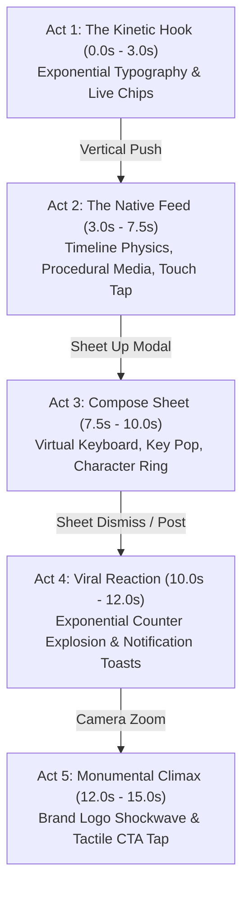
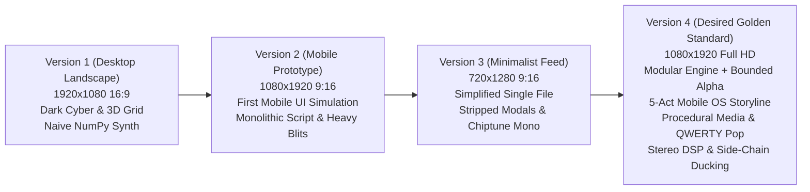

# Vertical Mobile Ad & Product Simulation Architecture (V4 Desired Framework)

The transition from landscape desktop showcases to **Full HD Vertical Video (1080x1920 @ 30 FPS)** represents the current pinnacle in procedural motion design. Modern audience attention is captured on vertical mobile surfaces (TikTok, Instagram Reels, YouTube Shorts, X Timeline). Simulating an authentic mobile operating system session with native touch gestures, feed scrolling, interactive typing modals, and notification explosions creates unparalleled viewer engagement.



---

## 1. Architectural Evolution: V1 vs V2 vs V3 vs V4 (Why V4 is the Desired Golden Standard)

The procedural motion engine evolved through four distinct architectural paradigms before establishing Version 4 as the golden standard for broadcast-grade mobile ads:



### Detailed Evolution Matrix

| Engineering Dimension | Version 1 (`X ad 1`) | Version 2 (`X ad 2`) | Version 3 (`X ad 3`) | Version 4 (`X ad 4` - Desired Golden Standard) |
| :--- | :--- | :--- | :--- | :--- |
| **Target Platform** | Desktop / TV Landscape ($1920\times 1080$, 16:9) | Mobile Vertical ($1080\times 1920$, 9:16) | Mobile Vertical ($720\times 1280$, 9:16) | **Full-HD Mobile Vertical ($1080\times 1920$, 9:16)** |
| **Visual World & Narrative** | Dark Cyber sci-fi space: 3D wireframe vanishing grid, drifting particle dust, 3 static horizontal cards side-by-side | Mobile app simulation prototype: SpaceX telemetry box, Elon post, modal compose, viral analytics card | Minimalist flat feed: stripped down text-only posts, kinetic cards cycling, simple end button | **Hyper-realistic mobile OS simulation: 5-Act storyline, kinetic typography pushes, generative animated media, QWERTY typing, viral toasts** |
| **Anti-Aliasing (AA)** | $1\times$ native rasterization (visible pixel stepping on diagonals & text) | $1.5\times$ SSAA Lanczos downsampling ($1620\times 2880$ virtual canvas) | $1.5\times$ SSAA Lanczos downsampling ($1080\times 1920$ virtual canvas) | **$1.5\times$ SSAA Lanczos + Bounded Alpha Blitting (`_alpha`)** |
| **Blitting & Performance** | Sequential single-threaded rendering | Monolithic single-threaded, full-frame alpha blitting (high memory & CPU overhead) | Compact single-threaded loop | **Multiprocessing pool (`multiprocessing.Pool`), chunked pipes to ffmpeg, fast `--preview` CLI** |
| **Typography & Layout** | Hardcoded text boxes, rigid desktop layout | Hardcoded text positions, static card bounding boxes | Basic programmatic word wrap (`wrap`) | **Dynamic word wrap (`wrap`), automated height calculation (`layout_post`), adaptive font sizing (`fit_size`)** |
| **Feed Media Fidelity** | Static 2D cards side-by-side | Static SpaceX telemetry text box | Text-only posts (no media cards) | **Three procedural generative animated media cards: (1) Rocket launch with smoke/flames, (2) Soccer scoreboard with confetti, (3) Sunset shimmer** |
| **Micro-Interactions** | None (pure motion graphic) | Basic touch tap indicator, heart scale pop, button 8% depression | Simplified heart pop, outline button ripple | **Touch tap indicator (pad + compression + ripple), QWERTY key pop magnification, confetti burst on like, tactile CTA click** |
| **Modal & Keyboard** | None | Slide-up compose modal, static keyboard base | None (removed completely) | **Modal `sheet_up` transition, live typing ticks, circular character counter ring, full QWERTY keyboard with spring key pop-up** |
| **Transitions** | Horizontal slide & warp streak tunnel cut | Single vertical push between Act 1 & 2; abrupt scene cuts elsewhere | Hard flash cuts (white blend on cut timestamps) | **Complete modular transition suite: `vertical_push`, `sheet_up`, `sheet_down`, `zoom`** |
| **Audio Engine** | Naive NumPy synth: ambient drone, simple kick/hat/bass, no filters | SciPy Butterworth SOS filters, 120 BPM beat, sidechain ducking | Minimal mono audio in same file: `np.sign` chords, no SciPy filters, no Foley | **Stereo binaural DSP in A minor, Butterworth SOS filters, detuned saw pads with cutoff sweep, kick sidechain ducking, frame-accurate UI Foley** |
| **Code Structure** | Monolithic 683-line script + 189-line audio | Monolithic 840-line script + 303-line audio | Monolithic 232-line single script | **Clean modular separation: `x_ad.py` (visual engine) + `x_ad_audio.py` (DSP audio) + `motion_engine.py` (shared math)** |

---

## 2. The 5-Act Mobile Narrative Arc (V4 Standard)

In a 15-second commercial, every frame must serve a narrative purpose. The **Hook-Feed-Compose-React-End** architecture structures pacing for maximum retention:

| Act | Time Window | Scene Purpose | Motion Mechanics |
| :--- | :--- | :--- | :--- |
| **Act 1: The Hook** | $0.00\text{s} - 3.05\text{s}$ | Stop the scroll; pose questions with exponential text slams. | `HOOK` stack with 4 phrases slamming on 120 BPM downbeats, stacked upward pushes aging prior lines to grey, pulsing "Happening now" live chip, hero slam "It's all happening.", and cyan underline sweep. |
| **Act 2: The Feed** | $3.05\text{s} - 7.55\text{s}$ | Immerse viewer in authentic timeline experience. | Momentum scroll physics, dynamic post wrapping, 3 procedural animated media cards (rocket launch, sports score, sunset), interactive touch tap indicator, confetti heart burst, and FAB tap. |
| **Act 3: Compose** | $7.55\text{s} - 10.05\text{s}$ | Put the viewer in the creator's seat. | Modal slide-up (`sheet_up`) over dimmed feed, audience dropdown pill ("Everyone"), live typing ticks, circular radial character counter, and full QWERTY keyboard with spring key pop-up magnification. |
| **Act 4: Reaction** | $10.05\text{s} - 12.05\text{s}$ | Emotional payoff: immediate viral validation. | Ramping counter metrics to 284K+ views (`ease_out_expo`), floating sinusoidal hearts, 3 staggered notification toasts sliding in from right (`ease_out_back`), floating caption pill, and bell badge climbing to "99+". |
| **Act 5: Climax & CTA** | $12.05\text{s} - 15.00\text{s}$ | Brand permanence & call to action. | Camera zoom transition into dark canvas, brand logo reveal with dual expanding shockwaves and precomputed Gaussian radial glow map (`glow_map`), tactile CTA button click depression (8%), and ripple. |

---

## 2. Super-Sampled Anti-Aliasing (SSAA) Canvas Pattern

At $1080 \times 1920$, rendering diagonal lines, serrated badges, and fine typography at $1\times$ causes visible raster stair-stepping. The V4 architecture renders to a virtual canvas multiplied by scale factor $K = 1.5$ ($1620 \times 2880$) and downsamples with Lanczos filtering:

```python
class Canvas:
    """Super-sampled drawing surface; all external coordinates are in output pixels."""
    def __init__(self, bg=(0, 0, 0), w=1080, h=1920, k=1.5):
        self.w, self.h, self.k = w, h, k
        self.im = Image.new("RGB", (int(w * k), int(h * k)), bg)
        self.d = ImageDraw.Draw(self.im)

    def rect(self, x0, y0, x1, y1, fill=None, r=0, outline=None, width=1):
        b = [x0 * self.k, y0 * self.k, x1 * self.k, y1 * self.k]
        wd = max(1, int(round(width * self.k)))
        if r > 0:
            self.d.rounded_rectangle(b, radius=min(r, (x1-x0)/2, (y1-y0)/2) * self.k, fill=fill, outline=outline, width=wd)
        else:
            self.d.rectangle(b, fill=fill, outline=outline, width=wd)

    def ell(self, cx, cy, r, fill=None, outline=None, width=1, ry=None):
        ry = r if ry is None else ry
        self.d.ellipse([(cx - r) * self.k, (cy - ry) * self.k, (cx + r) * self.k, (cy + ry) * self.k],
                       fill=fill, outline=outline, width=max(1, int(round(width * self.k))))

    def render(self):
        return self.im.resize((self.w, self.h), Image.LANCZOS)
```

### High-Performance Bounded Alpha Blitting
Full-screen alpha compositing on high-resolution buffers is slow. V4 introduces **bounding-box alpha drawing**: allocating small alpha masks only around the geometry to be blended:

```python
def _alpha(self, x0, y0, x1, y1, color, a, draw_fn):
    a = clamp(a)
    if a <= 0: return
    X0, Y0 = int(math.floor(x0 * self.k)) - 2, int(math.floor(y0 * self.k)) - 2
    X1, Y1 = int(math.ceil(x1 * self.k)) + 2, int(math.ceil(y1 * self.k)) + 2
    if X1 <= X0 or Y1 <= Y0: return
    m = Image.new("L", (X1 - X0, Y1 - Y0), 0)
    draw_fn(ImageDraw.Draw(m), X0, Y0, int(255 * a))
    self.im.paste(color, (X0, Y0, X1, Y1), m)
```

---

## 3. Native Touch Interaction Simulator

To simulate a real human interacting with a smartphone screen, V4 renders an authentic touch indicator:
1. A translucent finger contact pad fades in before the tap.
2. The pad contracts slightly, simulating mechanical fingertip compression.
3. Upon release, an expanding circular shockwave ripple discharges outward.

```python
def tap(c: Canvas, x: float, y: float, t: float, t_tap: float,
        col: tuple = (255, 255, 255), ripple: tuple = (29, 155, 240)):
    """Simulates touch contact: soft finger press followed by shockwave ripple."""
    # Finger contact dot
    a = min(prog(t, t_tap - 0.32, t_tap - 0.06), 1 - prog(t, t_tap + 0.12, t_tap + 0.42))
    if a > 0:
        press = clamp(prog(t, t_tap - 0.06, t_tap + 0.02) - prog(t, t_tap + 0.08, t_tap + 0.24))
        r = 46 * (1 - 0.22 * press)
        c.alpha_ell(x, y, r, col, 0.32 * a)
        c.alpha_ell(x, y, r, col, 0.55 * a, width=3)
        
    # Expanding shockwave ripple
    if t_tap < t < t_tap + 0.6:
        p = prog(t, t_tap, t_tap + 0.6)
        c.alpha_ell(x, y, 40 + ease_out_cubic(p) * 120, ripple, 0.9 * (1 - p), width=5)
```

---

## 4. Mobile Screen Navigation Transitions

Mobile UX does not rely on random crossfades or slide transitions. It obeys strict spatial hierarchies:

### 4.1 Vertical Push (`push`)
The incoming screen pushes the outgoing screen vertically upward, preserving timeline momentum:
```python
def vertical_push_transition(cur: Image.Image, prev: Image.Image, p: float) -> Image.Image:
    k = ease_in_out_cubic(clamp(p, 0.0, 1.0))
    off = int(k * cur.height)
    canvas = Image.new("RGB", cur.size)
    canvas.paste(prev, (0, -off))
    canvas.paste(cur, (0, cur.height - off))
    return canvas
```

### 4.2 Modal Sheet Slide-Up (`sheet_up`)
The incoming compose sheet slides up from the bottom of the device while the underlying timeline screen dims to 40% luminance. The system status bar remains fixed on top:
```python
def transition_sheet_up(cur: Image.Image, prev: Image.Image, p: float, w: int = 1080, h: int = 1920) -> Image.Image:
    base = Image.blend(prev, Image.new("RGB", prev.size, (0, 0, 0)), clamp(0.6 * p))
    y_off = int((1.0 - ease_out_cubic(p)) * (h - 100))
    sheet = cur.crop((0, 100, w, h))
    base.paste(sheet, (0, 100 + y_off))
    return base
```

---

## 5. Virtual Keyboard & Keystroke Magnification

To recreate a realistic typing experience on mobile:
1. Render a complete iOS/Android QWERTY keyboard layout.
2. Calculate the active key for each frame based on the current character index.
3. Draw a magnified key preview bubble above the pressed key that pops out using `ease_out_back`:

```python
def draw_key_press(c: Canvas, key_char: str, x0: float, y0: float, x1: float, y1: float, act_t: float):
    s = ease_out_back(clamp(act_t / 0.05), 2.0)
    px0, px1 = x0 - 14 * s, x1 + 14 * s
    # Raised bubble
    c.rect(px0, y0 - 128 * s, px1, y1, fill=(140, 140, 146), r=18)
    # Magnified letter
    c.txt((x0 + x1) / 2, y0 - 62 * s, key_char, 70 * s, (255, 255, 255), "mm", "regular")
```

---

## 6. Real-Time Notification Toasts & Badge Ramping

In Act 4, viral explosion is communicated through stacked UI feedback:
1. **Exponential Counter Interpolation**:
   ```python
   g = ease_out_expo(prog(lt, 0.15, 1.7))
   views = int(284000 * g)
   likes = int(12400 * g)
   ```
2. **Notification Toasts**: Slide in from the right ($x_{\text{off}} = (1 - e) \cdot 260\text{px}$) with verified badges, profile avatars, and customized action icons.
3. **Bottom Nav Badge Counter**: Ramps dynamically from 3 to "99+" inside the bell icon pill.

---

## 7. Multi-Core Parallel Rendering Pipeline

Rendering 450 frames at $1080 \times 1920$ with $1.5\times$ supersampling takes substantial CPU cycles on a single thread. The V4 architecture harnesses Python's `multiprocessing.Pool` with chunked pipes directly into `imageio-ffmpeg`:

```python
from multiprocessing import Pool
import imageio_ffmpeg

def render_frame(i):
    return np.ascontiguousarray(np.asarray(frame_at(i / FPS), dtype=np.uint8))

def main():
    writer = imageio_ffmpeg.write_frames("output.mp4", (1080, 1920), fps=30,
                                         codec="libx264", output_params=["-crf", "17", "-preset", "medium"],
                                         audio_path="soundtrack.wav", audio_codec="aac")
    writer.send(None)
    with Pool(os.cpu_count() or 4) as pool:
        for fr in pool.imap(render_frame, range(TOTAL_FRAMES), chunksize=3):
            writer.send(fr)
    writer.close()
```

This yields full broadcast-grade 1080p H.264 video with synchronized procedural soundtrack in seconds.
