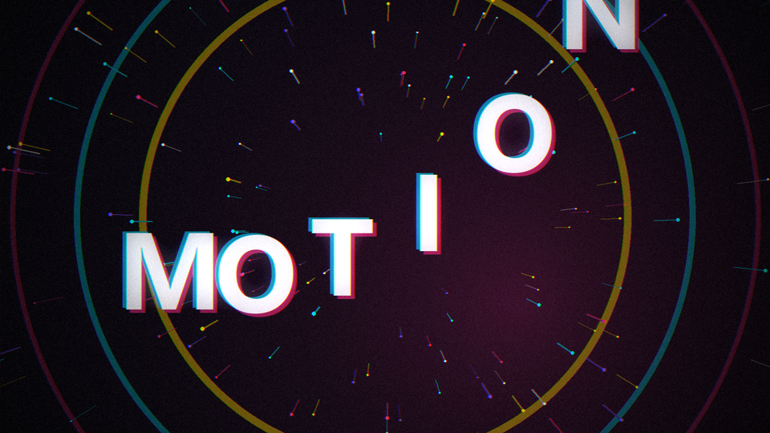
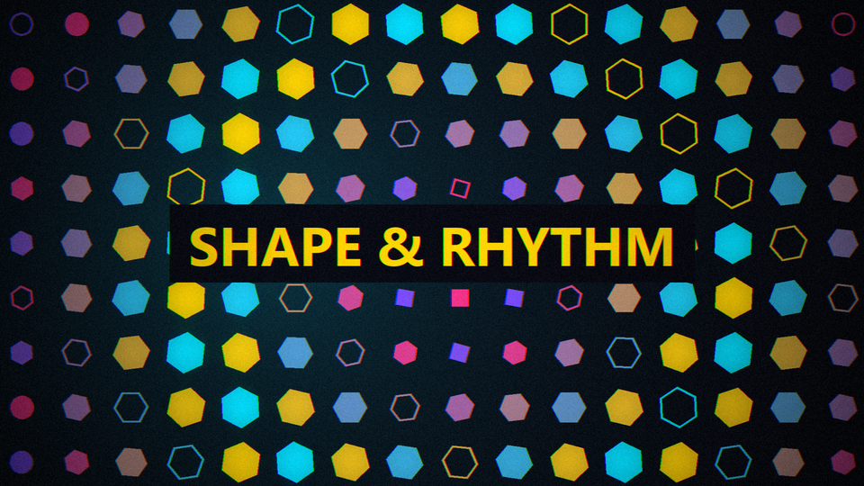
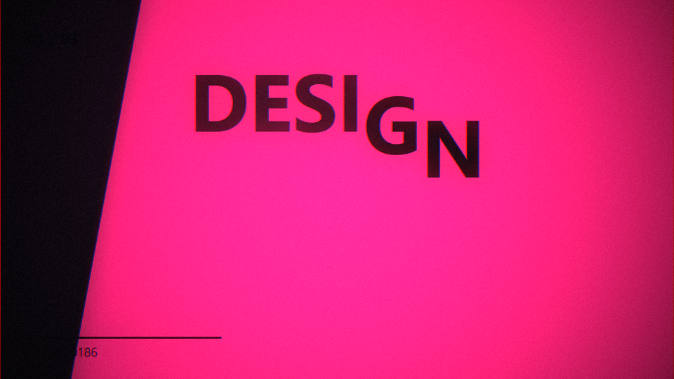
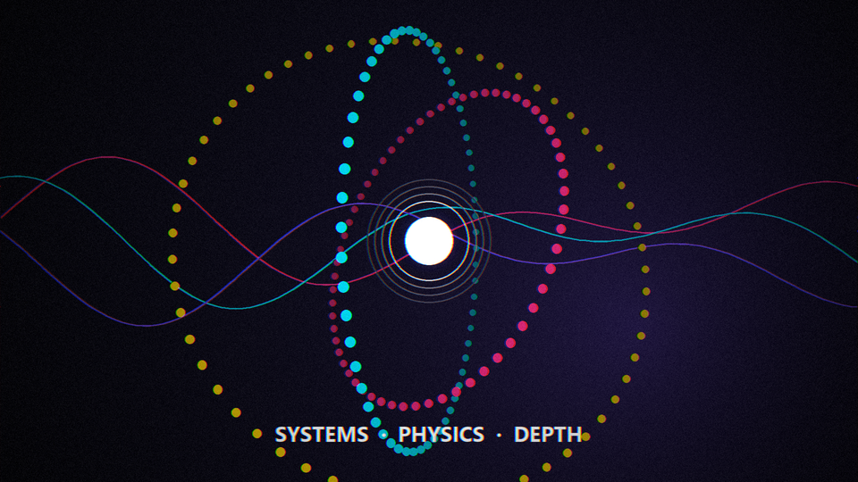
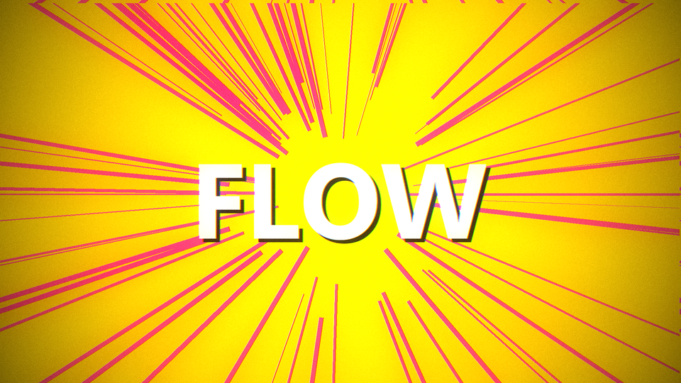
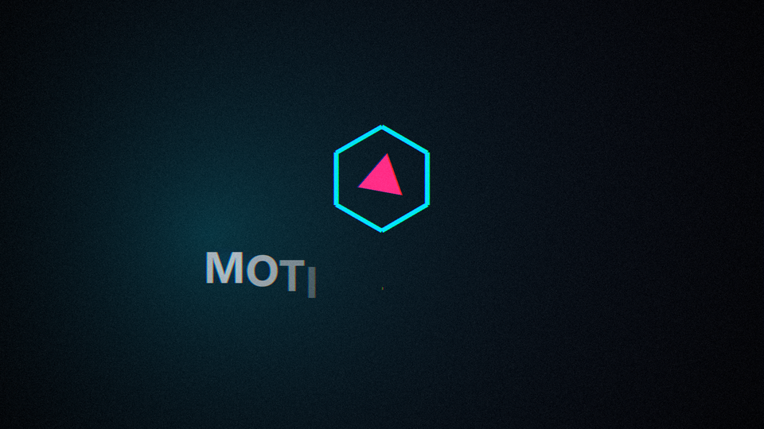
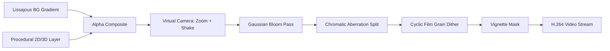

# 🎬 Procedural Motion Graphics (Python)

[](https://www.python.org/)
[](https://opensource.org/licenses/MIT)
[](https://github.com/gnustella-lab/procedural-motion-graphics)
[-green.svg)](#)

A complete, broadcast-grade procedural motion graphics and video synthesis system written entirely in pure Python (**Pillow + NumPy + imageio-ffmpeg**).

Every frame is a deterministic mathematical function of time $t \in \mathbb{R}$. No After Effects, no Blender, no video editor, and no stock footage.

---

## 📽️ Showreel Highlights


> **Output**: 1080p @ 30fps H.264 video rendered frame-by-frame directly in Python.

---

## 🌟 Key Features

- **Mathematical Easing Engine**: Pure Python implementations of Cubic In/Out, Exponential Snappiness, Back (Overshoot Bounce), and Elastic Damped Harmonic Oscillation.
- **Cinematic Multi-Pass Compositing**:
  - Lissajous dual-radial animated backgrounds with scene-specific color grading.
  - Downsampled 4x Gaussian bloom/glow pass with luminance thresholding.
  - Dynamic chromatic aberration with transition glitch spikes.
  - Precomputed cyclic Gaussian film grain plates (eliminates 8-bit H.264 gradient banding).
  - Quadratic vignette falloff and 2-frame cut flash whiteouts.
  - Virtual camera with subpixel bicubic zoom and positional impact jitter.
- **2D/3D Procedural Effects**:
  - 3D orbital particle clouds with Euler rotation matrices and Painter's Algorithm depth sorting.
  - Real-time regular polygon vertex morphing (triangle $\to$ square $\to$ hexagon $\to$ circle).
  - Harmonic traveling sine wave grids with Euclidean distance bloom delays.
  - Kinetic typography with glyph advance metrics, per-letter stagger, and chromatic faux extrusions.
  - Luminance track mattes (`ImageChops.multiply`) and vector stroke reveal ("trim paths").
- **Universal Agentic Skill**: Direct compatibility with **Google Antigravity**, **Claude Code**, **Hermes Agent**, and standard Python CLI environments.

---

## 🖼️ Scene Breakdown Gallery

| 01. Ignition (0.0s - 2.4s) | 02. Shape & Rhythm (2.4s - 5.2s) |
| :---: | :---: |
|  |  |
| *Dot squash, shockwave rings, 220-particle burst with velocity trails, kinetic title drop.* | *16x9 grid radial bloom, traveling sine ripples, vertex count polygon morphing, track matte text.* |

| 03. Kinetic Typography (5.2s - 8.4s) | 04. Systems & 3D Depth (8.4s - 11.2s) |
| :---: | :---: |
|  |  |
| *Skewed polygon wipe panels, per-letter tracking stagger, Swiss HUD metadata counters.* | *3D particle rings, perspective projection, depth-sorted atmospheric fog, compound sine ribbons.* |

| 05. Climax Cuts (11.2s - 13.2s) | 06. Brand Resolve (13.2s - 15.0s) |
| :---: | :---: |
|  |  |
| *4-frame strobe cuts (7.5 Hz), manga speed lines, hazard stripes, spinning concentric squares.* | *Iris transition, vector line-draw hexagon ("trim paths"), elastic inner triangle, title resolve.* |

---

## 🚀 Installation & Skill Setup

### 1. Install Dependencies

```bash
pip install numpy pillow imageio imageio-ffmpeg
```

### 2. Use as an Agent Skill

#### In Google Antigravity
Clone this repository directly into your project's `.agents/skills/` directory or your global skills configuration:
```bash
git clone https://github.com/gnustella-lab/procedural-motion-graphics.git .agents/skills/procedural-motion-graphics
```

#### In Hermes Agent
```bash
git clone https://github.com/gnustella-lab/procedural-motion-graphics.git ~/.hermes/skills/procedural-motion-graphics
```

#### In Claude Code
```bash
git clone https://github.com/gnustella-lab/procedural-motion-graphics.git ~/.claude/skills/procedural-motion-graphics
```

---

## ⚡ Quickstart

### Render the Full Showreel

```bash
python scripts/render_showreel.py showreel.mp4
```

### Instant Single-Frame Preview (Visual Debugging in 0.5s)

Prototyping motion graphics frame-by-frame is instantaneous:

```bash
# Render frame at t=1.2s
python scripts/preview_frame.py --time 1.2 --output preview.png

# Render all 6 scene still frames
python scripts/preview_frame.py --all-scenes --output-dir assets/
```

### Minimal 3-Second Kinetic Title

```python
import numpy as np
from PIL import Image, ImageDraw
import imageio.v2 as imageio
from scripts.motion_engine import ease_out_back, prog, lerp, get_font, apply_glow_bloom

W, H, FPS = 1920, 1080, 30
cx, cy = W / 2, H / 2
font = get_font(180, bold=True)

writer = imageio.get_writer("title.mp4", fps=FPS, codec="libx264", quality=9, pixelformat="yuv420p")

for frame in range(90):  # 3 seconds
    t = frame / FPS
    layer = Image.new("RGBA", (W, H), (0, 0, 0, 0))
    draw = ImageDraw.Draw(layer)

    # Overshoot bounce entrance
    q = ease_out_back(prog(t, 0.2, 1.2), s=2.0)
    y = lerp(-200, cy, q)

    # Chromatic offset extrusion
    draw.text((cx + 6, y + 6), "MOTION", font=font, fill=(255, 46, 136, 160), anchor="mm")
    draw.text((cx - 6, y - 4), "MOTION", font=font, fill=(0, 229, 255, 160), anchor="mm")
    draw.text((cx, y), "MOTION", font=font, fill=(245, 245, 250, 255), anchor="mm")

    # Composite & bloom
    img = np.array((10, 10, 18), np.float32) * (1.0 - np.asarray(layer)[..., 3:4]/255) + np.asarray(layer)[..., :3] * (np.asarray(layer)[..., 3:4]/255)
    img = apply_glow_bloom(img, threshold=80, intensity=0.5)
    writer.append_data(img.clip(0, 255).astype(np.uint8))

writer.close()
```

---

## 📐 Compositing Pipeline Architecture



---

## 📁 Repository Structure

```text
procedural-motion-graphics/
├── SKILL.md                                 # Main Agentic Skill specification
├── README.md                                # Public GitHub presentation & guides
├── LICENSE                                  # MIT License
├── showreel.py                              # Master 15s showreel source
├── showreel_breakdown.txt                   # Detailed creative & technical notes
├── assets/                                  # Pre-rendered stills and animated GIF
│   ├── showreel_preview.gif
│   ├── scene1_ignition.png
│   ├── ...
├── scripts/                                 # Executable utilities & modular engine
│   ├── motion_engine.py                     # Reusable math, 3D, and compositing library
│   ├── render_showreel.py                   # Production CLI video renderer
│   └── preview_frame.py                     # Fast single-frame preview CLI
├── examples/                                # Standalone tutorials and recipes
│   ├── 01_quickstart_kinetic_title.py       # Kinetic typography & chromatic extrude
│   ├── 02_radial_shape_bloom.py             # Geometric polygon vertex morphing
│   ├── 03_orbital_particles_3d.py           # 3D perspective particle system
│   ├── 04_logo_stroke_reveal.py             # Trim paths vector line-draw & elastic pop
│   └── 05_strobe_rhythmic_cuts.py           # High-energy 4-frame strobe cuts
└── references/                              # In-depth technical documentation
    ├── animation-math-and-easings.md        # Easing curves, harmonic waves, physics
    ├── compositing-pipeline.md              # Multi-pass bloom, CA, grain, camera
    ├── 3d-projection-in-2d.md               # Euler rotations & perspective divide
    ├── kinetic-typography-and-mattes.md     # Advance metrics & track mattes
    └── creative-direction-and-pacing.md     # 6-stage energy curves & editing rhythm
```

---

## 📄 License

MIT License. Free for personal, commercial, and educational use.
