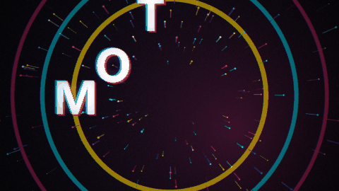

# 🎬 Procedural Motion Graphics (Python)

[](https://www.python.org/)
[](https://opensource.org/licenses/MIT)
[](https://github.com/gnustella-lab/procedural-motion-graphics)
[-green.svg)](#)

A complete, broadcast-grade procedural motion graphics and video synthesis system written entirely in pure Python (**Pillow + NumPy + SciPy + imageio-ffmpeg**).

Every frame is a deterministic mathematical function of time $t \in \mathbb{R}$. No After Effects, no Blender, no video editor, and no stock footage.

---

## 📽️ Showreel Highlights



> **Output**: 1080p @ 30fps H.264 video rendered frame-by-frame directly in Python with synchronized procedural audio.

---

## 🌟 The Four Design Pillars

The engine provides full procedural support for four progressive design paradigms, with **Pillar 1 (V4)** serving as the desired golden standard:

### 1. Full-HD Vertical Mobile Product Ad & Procedural DSP Audio (Version 4 - Desired & Recommended)
- **Concept**: **"The Product IS the Commercial"**. Native 1080x1920 (9:16 vertical) broadcast ad engineered for modern social feeds (TikTok, Instagram Reels, YouTube Shorts, X Timeline).
- **5-Act Narrative Arc**:
  - **Act 1: The Kinetic Hook ($0.0 - 3.0\text{s}$)**: High-energy kinetic typography slammed with exponential acceleration, pulsing live chips ("Happening Now"), and cyan underline sweeps.
  - **Act 2: The Native Feed ($3.0 - 7.5\text{s}$)**: Realistic timeline feed with momentum scroll physics, procedural animated media cards (rocket launch with procedural smoke particles and flames, sports score with live confetti), and authentic touch tap indicators triggering heart scale pops and particle bursts.
  - **Act 3: Compose Sheet Modal ($7.5 - 10.0\text{s}$)**: Slide-up bottom sheet modal (`sheet_up`) over dimmed background, full QWERTY keyboard with active key magnification pop-up, live typing ticks, and Post button tap ripple.
  - **Act 4: Viral Payoff ($10.0 - 12.0\text{s}$)**: Explosive counter metrics, floating heart physics, staggered incoming notification toasts sliding in from the right, and bottom nav notification badge climbing to "99+".
  - **Act 5: Monumental Climax & CTA ($12.0 - 15.0\text{s}$)**: Zoom cut into dark canvas, brand logo reveal with dual expanding shockwaves and radial glow, tactile CTA button click depression (8%), and ripple.
- **Procedural Audio DSP Engine**:
  - Pure Python synthesis with NumPy & SciPy Butterworth filters (`scipy.signal.butter` / `sosfilt`).
  - Side-chain ducking: Kick triggers exponential envelope ducking on the synth pad and bass.
  - Frame-accurate UI Foley sound design: word slam ticks, transition whooshes, touch tap clicks, heart pop bubbles, keystroke tick-clacks, post send whoosh, ascending notification chimes, and sub-drop impact booms.

### 2. Horizontal App UI & Product Simulation (Version 3)
- **Concept**: **"The Resume IS the App"**. Interactive digital music player (Spotify/Apple Music) in 16:9 landscape ($1280\times 720$).
- **Features**: Synced karaoke lyrics, playlist tracklists with 3-bar animated green equalizer bars (`mini_eq_bars`), generative geometric album covers, and desktop mouse pointer click depression.

### 3. Flat Editorial / "Spotify Wrapped" (Version 2)
- **Aesthetic**: Saturated color-block scenes (Green, Purple, Orange, Blue, Black), crisp typography with hard offset drop shadows (`offset 8, 8`), rounded pill badges, ranked countdown charts, spinning vinyl turntables, and dynamic waveform scrubbers.
- **Physics**: Damped harmonic spring physics ($1 - e^{-kx}\cos(\omega x)$), squash & stretch ground impacts, dynamic floor contact shadows, and `smoothstep` wipes.

### 4. Dark Cyber Glow Compositing (Version 1)
- **Aesthetic**: Deep midnight navy backgrounds (`#080812`), drifting Lissajous radial gradients, and neon typography with chromatic 3D extrusions.
- **3D & Particles**: Perspective-projected 3D orbital particle clouds, Euler rotation matrices, and Painter's Algorithm depth sorting.

---

## 📊 Architectural Evolution Matrix (V1 $\to$ V2 $\to$ V3 $\to$ V4)

| Dimension | Version 1 (`X ad 1` Desktop) | Version 2 (`X ad 2` Mobile Prototype) | Version 3 (`X ad 3` Minimalist Feed) | Version 4 (`X ad 4` - Desired Golden Standard) |
| :--- | :--- | :--- | :--- | :--- |
| **Aspect Ratio & Resolution** | 1920x1080 (16:9 Landscape) | 1080x1920 (9:16 Vertical) | 720x1280 (9:16 Vertical) | **1080x1920 Full HD (9:16 Vertical)** |
| **Visual Tone & World** | Sci-Fi 3D wireframe grid & floating dust | Mobile UI simulation with static text boxes | Minimal flat feed scroll, text-only posts | **Hyper-realistic native mobile OS & timeline simulation with generative animated media** |
| **Anti-Aliasing & Blits** | 1x standard PIL (aliased) | 1.5x SSAA Lanczos, full-frame blits | 1.5x SSAA Lanczos (Pen class) | **1.5x SSAA Lanczos + Bounded Alpha Blits (`_alpha`)** |
| **Interactivity & Gestures** | None (pure broadcast video) | Touch tap indicator, heart scale pop, button 8% depression | Simplified heart pop, outline button ripple | **Touch tap indicator (pad + dip + shockwave ripple), QWERTY key pop magnification, confetti burst on like** |
| **Modals & Keyboard** | None | Slide-up modal sheet, static keyboard | None (stripped out) | **Modal `sheet_up` slide, live typing ticks, circular character counter, virtual QWERTY keyboard with spring key pop** |
| **Dynamic Notifications** | None | Analytics card, 3 sliding toasts | None | **Exponential counter ramping (284K+), floating sinusoidal hearts, 3 sliding notification toasts, bell badge to "99+"** |
| **Audio Engine** | Naive NumPy synth, ambient drone | Initial SciPy SOS filter integration | Minimal mono chiptune-style audio in single file | **Stereo binaural DSP in A minor, Butterworth SOS filters, cutoff sweep, kick side-chain ducking, frame-accurate UI Foley** |
| **Rendering Pipeline** | Single-threaded | Monolithic single-threaded | Single-threaded | **Multi-core parallel processing (`multiprocessing.Pool`), chunked pipes to ffmpeg, fast CLI `--preview`** |
| **Code Structure** | Monolithic 683-line visual script | Monolithic 840-line script | Monolithic 232-line single script | **Clean modular separation: `x_ad.py` + `x_ad_audio.py` + `motion_engine.py`** |

---

## 🚀 Installation & Skill Setup

### 1. Install Dependencies

```bash
pip install numpy pillow scipy imageio imageio-ffmpeg
```

### 2. Use as an Agent Skill

#### In Google Antigravity
Clone this repository directly into your project's `.agents/skills/` directory:
```bash
git clone https://github.com/gnustella-lab/procedural-motion-graphics.git .agents/skills/procedural-motion-graphics
```

---

## ⚡ Quickstarts

### Option A: Vertical Mobile Social Ad (V4 Desired Architecture)

Run the full vertical social ad simulation:

```bash
python examples/08_vertical_social_ad_simulation.py
```

### Option B: Native App UI Simulation (V3 Horizontal Style)

```bash
python examples/07_app_ui_product_simulation.py
```

### Option C: Instant Frame Inspection CLI

Generate keyframe previews in 0.5s:

```bash
python scripts/preview_frame.py --time 1.2 -o preview.png
```

---

## 📁 Repository Structure

```text
procedural-motion-graphics/
├── SKILL.md                                 # Main Agentic Skill specification
├── README.md                                # Public GitHub presentation & guides
├── LICENSE                                  # MIT License
├── showreel.py                              # Master 15s Showreel render script
├── showreel_breakdown.txt                   # Scene-by-scene timing and creative bible
├── assets/                                  # Keyframe stills & animated previews
├── examples/                                # Standalone self-contained recipes
│   ├── 01_quickstart_kinetic_title.py       # Title sequence with bounce & bloom
│   ├── 02_radial_shape_bloom.py             # Geometric ray bursts & pulsing rings
│   ├── 03_orbital_particles_3d.py           # 3D perspective particle system
│   ├── 04_logo_stroke_reveal.py             # Vector emblem drawing animation
│   ├── 05_strobe_rhythmic_cuts.py           # Strobe cuts with chromatic aberration
│   ├── 06_flat_wrapped_editorial.py         # Saturated editorial, springs & iris wipes
│   ├── 07_app_ui_product_simulation.py      # Horizontal music app simulation (V3)
│   └── 08_vertical_social_ad_simulation.py  # Full-HD Vertical mobile commercial (V4 Desired)
├── references/                              # Deep technical manuals
│   ├── vertical-mobile-ad-architecture.md   # V4 Vertical Mobile Ad & 5-Act framework
│   ├── procedural-audio-dsp-and-sound-design.md # Pure Python sound synthesis & DSP
│   ├── app-ui-and-product-simulation.md     # Native UI & interaction mechanics
│   ├── animation-math-and-easings.md        # Mathematical easing functions & springs
│   ├── polar-shape-morphing-and-ui.md       # 2D polar geometry & morphing
│   ├── 3d-projection-in-2d.md               # 3D rotations & perspective division
│   ├── kinetic-typography-and-mattes.md     # Text measurement & track mattes
│   ├── compositing-pipeline.md              # Multi-pass bloom, chromatic aberration, grain
│   └── creative-direction-and-pacing.md     # Pacing guidelines & comparative matrices
└── scripts/
    ├── motion_engine.py                     # Universal mathematical & rendering toolkit
    ├── preview_frame.py                     # Rapid single-frame inspection tool
    └── render_showreel.py                   # High-performance showreel compiler
```

---

## 📜 License

MIT License. Free to use in commercial and personal projects.
